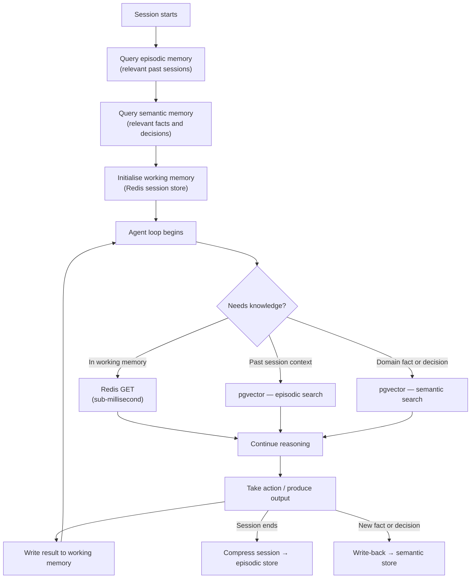
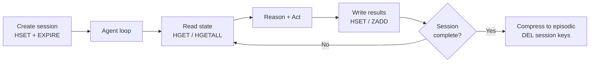
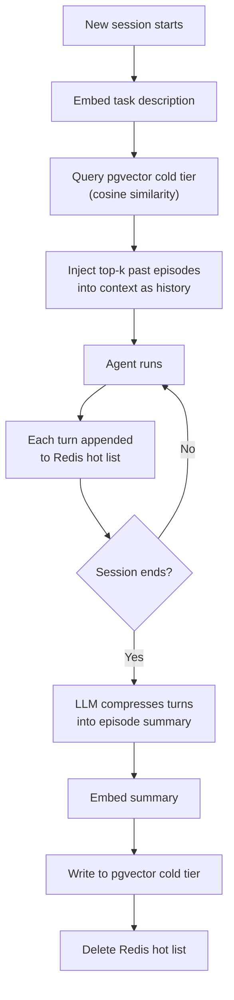
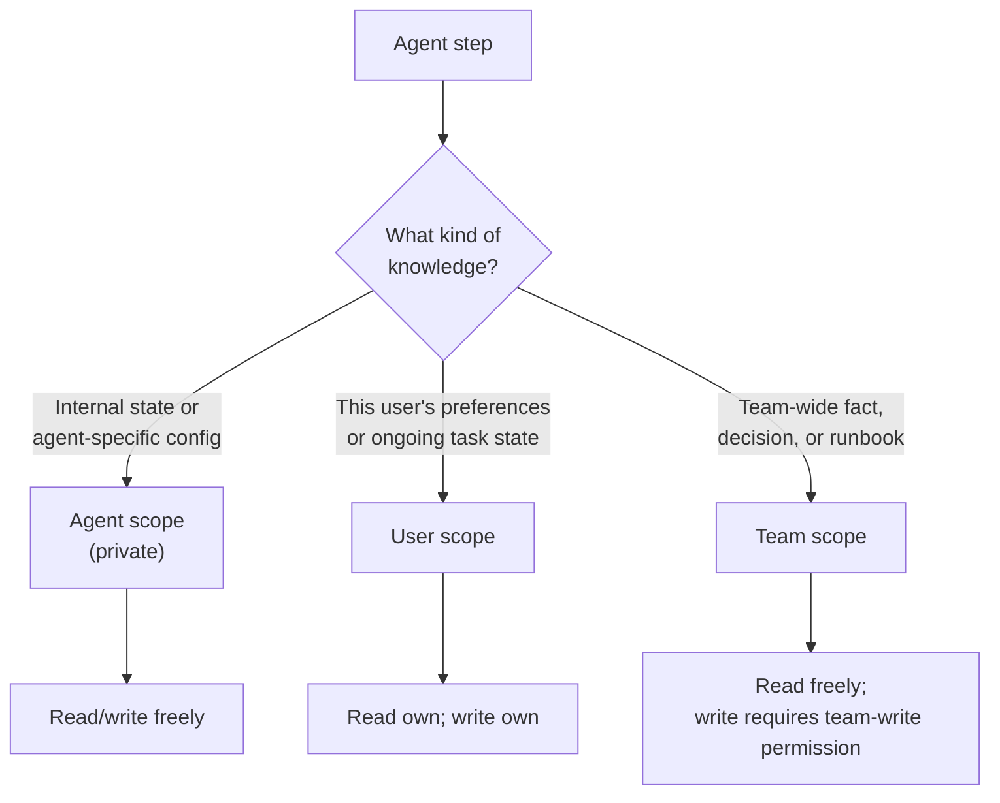
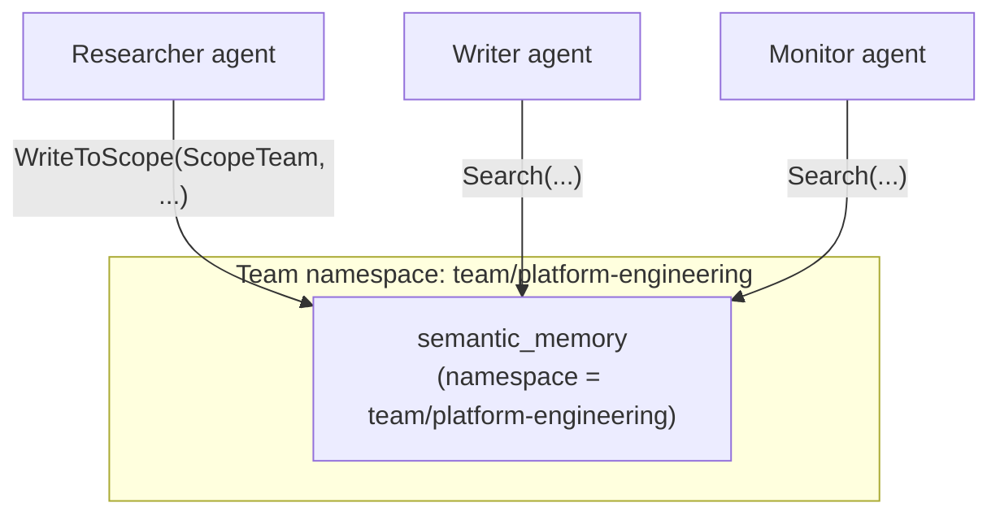
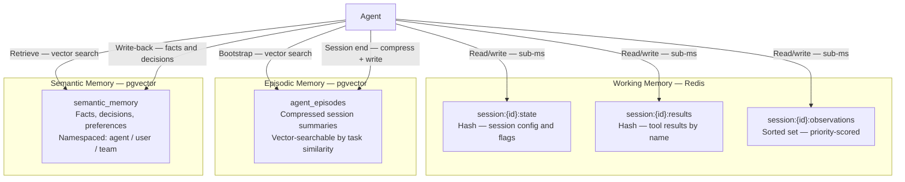
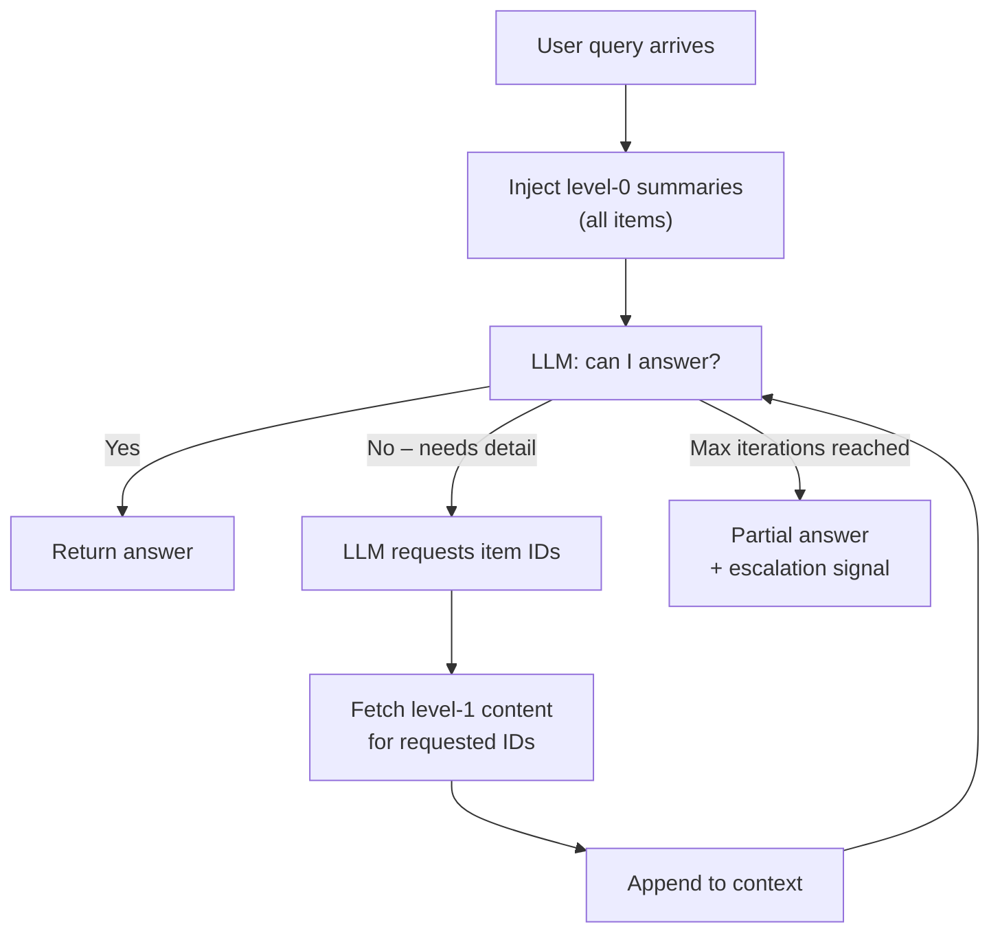

# Agent Memory

An agent that cannot remember is forced to rediscover the same facts on every run. Memory transforms a stateless request-processor into a system that accumulates knowledge, maintains continuity across sessions, and shares context with collaborators.

This series covers the full memory stack: how to design it, implement it in Go, and choose the right scope for production agents.

---

## Why Memory Matters

Context engineering controls what an agent knows *right now*. Memory controls what an agent knows *over time*.

Without memory:

- Every session starts from zero — the agent re-fetches the same data and re-reasons the same conclusions
- Long conversations exhaust the context window and lose early reasoning
- Multi-agent systems cannot build on each other's work
- User preferences, prior decisions, and accumulated findings evaporate between runs

Memory is not a luxury. For production agents doing real work, it is load-bearing infrastructure.

---

## Three Memory Types

Agents operate with three distinct memory types. Each has a different lifetime, storage technology, and access cost.

| Type | Lifetime | Technology | Access cost | Primary use |
|---|---|---|---|---|
| **Working** | One session | Redis | Sub-millisecond | Active session state, tool results, pending actions |
| **Episodic** | Across sessions | pgvector | Low (vector search) | Compressed history of past sessions |
| **Semantic** | Permanent | pgvector | Low (vector search) | Accumulated facts, decisions, domain knowledge |

These are not mutually exclusive. A running agent uses all three simultaneously.

---

## How They Compose

At session start, an agent bootstraps from episodic and semantic memory. During the session, working memory accumulates observations. At session end, the session is compressed back into episodic memory and important findings are written to semantic memory.



The agent loop maps directly onto memory:

| Loop phase | Memory involvement |
|---|---|
| **Perceive** | Load episodic context; retrieve semantic facts relevant to the incoming task |
| **Reason** | Read from working memory; retrieve additional knowledge on demand |
| **Act** | Execute tools; results land in working memory |
| **Observe** | Update working memory with observations; flag important findings for write-back |

---

## Technology Choices

**Redis** backs working memory. It is fast enough that a memory read never becomes a bottleneck, supports TTL-based expiry natively, and provides the right data structures: hashes for session state, sorted sets for priority-ordered observations, lists for ordered message history.

**pgvector** backs both episodic and semantic memory. Storing vectors alongside relational metadata in PostgreSQL means you get semantic similarity search and structured filtering in a single query — without a separate vector database to operate.

Both are standard platform services with established operational patterns.

---

## Relationship to Existing Series

This series builds on two prior foundations:

**Context Engineering** covers the token budget and how to structure what enters the context window. Working memory feeds context; this series explains what lives *outside* the window and how it gets in.

**Agentic Patterns Part 5** covers memory at the *design* level: the three types, their trade-offs, and the patterns for using them. This series covers *implementation*: concrete Go code, real storage backends, and production concerns like scoping, invalidation, and multi-agent sharing.

---

## Choosing the Right Memory Type

| Situation | Recommended memory |
|---|---|
| Tool result needed 3 steps later in the same session | Working (Redis) |
| User's name and communication preferences, set last week | Semantic (pgvector) |
| What went wrong in a similar incident two months ago | Episodic (pgvector) |
| Intermediate plan steps while executing a workflow | Working (Redis) |
| Architecture decision made last quarter | Semantic (pgvector) |
| The first 40 turns of today's long conversation | Episodic (pgvector) |
| A live API response fetched 2 steps ago | Working (Redis) |

When in doubt: **if it must survive a process restart, it needs persistent storage**. If it only needs to survive the session, Redis with a TTL is sufficient.

---

# Agent Memory Part 2: Working Memory

Working memory is the agent's scratchpad for a single session. It holds tool results, intermediate state, session configuration, and the priority-scored observations an agent accumulates while running — without injecting all of it into the context window at once.

Redis is the right backing store: sub-millisecond reads, native TTL-based expiry, and data structures that match the access patterns agents actually need.

---

## What Working Memory Holds

Working memory is not just conversation history. A typical agent session accumulates:

- **Tool results** — API responses, database records, computed values from prior steps
- **Intermediate state** — a partially-built plan, a list of items still to process
- **Session configuration** — which user, which tenant, which environment
- **Flags and decisions** — "we already checked this resource", "user approved this step"
- **Error state** — which tools failed, which have been retried

None of this needs to be in the context window simultaneously. The agent reads what it needs *right now*, acts, and writes what it learned back to working memory.

---

## Redis Data Structures

| Use case | Redis structure | Key pattern | Notes |
|---|---|---|---|
| Session state | Hash | `session:{id}:state` | One field per state variable |
| Tool results | Hash | `session:{id}:results` | Keyed by tool name |
| Priority-scored observations | Sorted set | `session:{id}:observations` | Score = priority; ZREVRANGE for top-k |
| Ordered message history | List | `session:{id}:messages` | RPUSH append; LRANGE read |

All keys carry a TTL. A session that is never explicitly closed will expire automatically.

---

## Session Lifecycle



---

## Go Implementation

### Session Store

```go
import (
    "context"
    "encoding/json"
    "errors"
    "fmt"
    "time"

    "github.com/redis/go-redis/v9"
)

type WorkingMemory struct {
    client    *redis.Client
    sessionID string
    ttl       time.Duration
}

func NewWorkingMemory(client *redis.Client, sessionID string, ttl time.Duration) *WorkingMemory {
    return &WorkingMemory{
        client:    client,
        sessionID: sessionID,
        ttl:       ttl,
    }
}

func (w *WorkingMemory) stateKey() string {
    return fmt.Sprintf("session:%s:state", w.sessionID)
}

func (w *WorkingMemory) resultsKey() string {
    return fmt.Sprintf("session:%s:results", w.sessionID)
}

func (w *WorkingMemory) observationsKey() string {
    return fmt.Sprintf("session:%s:observations", w.sessionID)
}
```

### Reading and Writing State

```go
func (w *WorkingMemory) SetState(ctx context.Context, key, value string) error {
    pipe := w.client.Pipeline()
    pipe.HSet(ctx, w.stateKey(), key, value)
    pipe.Expire(ctx, w.stateKey(), w.ttl)
    _, err := pipe.Exec(ctx)
    return err
}

func (w *WorkingMemory) GetState(ctx context.Context, key string) (string, error) {
    val, err := w.client.HGet(ctx, w.stateKey(), key).Result()
    if errors.Is(err, redis.Nil) {
        return "", nil // key not present — treat as empty, not an error
    }
    return val, err
}

func (w *WorkingMemory) AllState(ctx context.Context) (map[string]string, error) {
    return w.client.HGetAll(ctx, w.stateKey()).Result()
}
```

### Storing Tool Results

```go
func (w *WorkingMemory) StoreResult(ctx context.Context, toolName, result string) error {
    pipe := w.client.Pipeline()
    pipe.HSet(ctx, w.resultsKey(), toolName, result)
    pipe.Expire(ctx, w.resultsKey(), w.ttl)
    _, err := pipe.Exec(ctx)
    return err
}

func (w *WorkingMemory) GetResult(ctx context.Context, toolName string) (string, bool, error) {
    val, err := w.client.HGet(ctx, w.resultsKey(), toolName).Result()
    if errors.Is(err, redis.Nil) {
        return "", false, nil
    }
    if err != nil {
        return "", false, err
    }
    return val, true, nil
}
```

### Priority-Scored Observations

Not all observations are equally important. An agent that discovers a critical constraint should retain that observation even when older, lower-value observations are dropped to free context budget.

```go
type Observation struct {
    Content   string    `json:"content"`
    Source    string    `json:"source"`    // which tool produced this
    Timestamp time.Time `json:"timestamp"`
}

func (w *WorkingMemory) AddObservation(ctx context.Context, obs Observation, priority float64) error {
    data, err := json.Marshal(obs)
    if err != nil {
        return err
    }

    pipe := w.client.Pipeline()
    pipe.ZAdd(ctx, w.observationsKey(), redis.Z{
        Score:  priority,
        Member: string(data),
    })
    pipe.Expire(ctx, w.observationsKey(), w.ttl)
    _, err = pipe.Exec(ctx)
    return err
}

// TopObservations returns the highest-priority observations up to the given limit.
func (w *WorkingMemory) TopObservations(ctx context.Context, limit int) ([]Observation, error) {
    // ZREVRANGE returns members sorted high-to-low by score.
    results, err := w.client.ZRevRange(ctx, w.observationsKey(), 0, int64(limit-1)).Result()
    if err != nil {
        return nil, err
    }

    observations := make([]Observation, 0, len(results))
    for _, r := range results {
        var obs Observation
        if err := json.Unmarshal([]byte(r), &obs); err != nil {
            continue // skip malformed entries
        }
        observations = append(observations, obs)
    }
    return observations, nil
}
```

### Syncing Working Memory into Context

Working memory is only useful if the agent can load the right subset into the context window when needed. Loading everything defeats the purpose; loading nothing leaves the agent blind.

```go
type ContextLoader struct {
    memory       *WorkingMemory
    maxTokens    int
    tokenCounter func(string) int
}

// BuildContextSlice returns a minimal set of working memory entries
// that fit within the token budget, ordered by priority.
func (c *ContextLoader) BuildContextSlice(ctx context.Context) ([]string, error) {
    var entries []string
    used := 0

    // Always include session state — it is small and always relevant.
    state, err := c.memory.AllState(ctx)
    if err != nil {
        return nil, err
    }
    for k, v := range state {
        entry := fmt.Sprintf("%s: %s", k, v)
        cost := c.tokenCounter(entry)
        if used+cost > c.maxTokens {
            break
        }
        entries = append(entries, entry)
        used += cost
    }

    // Fill remaining budget with highest-priority observations.
    obs, err := c.memory.TopObservations(ctx, 20)
    if err != nil {
        return nil, err
    }
    for _, o := range obs {
        cost := c.tokenCounter(o.Content)
        if used+cost > c.maxTokens {
            break
        }
        entries = append(entries, o.Content)
        used += cost
    }

    return entries, nil
}
```

---

## TTL Strategy

| Memory class | Suggested TTL | Reasoning |
|---|---|---|
| Interactive chat session | 2 hours | Matches typical user engagement window |
| Background agent job | Job timeout + 10 minutes | State needed only while the job runs |
| Async multi-step workflow | 24 hours | Steps may be hours apart |
| Shared coordination state | 48 hours | Accommodates multi-timezone handoffs |

Set TTL on every write. Use Redis pipelines to set value and extend TTL atomically in one round-trip.

---

## Putting It Together

A working memory-aware step inside a ReAct agent loop. The result cache check avoids redundant tool calls when the agent revisits a question it has already answered.

```go
func (a *Agent) step(ctx context.Context, toolName string, params map[string]any) (string, error) {
    // Check if we already have this result cached in working memory.
    if result, ok, err := a.memory.GetResult(ctx, toolName); err != nil {
        return "", fmt.Errorf("reading working memory: %w", err)
    } else if ok {
        return result, nil // cache hit — skip the tool call
    }

    // Execute the tool.
    result, err := a.tools.Execute(ctx, toolName, params)
    if err != nil {
        return "", fmt.Errorf("executing %s: %w", toolName, err)
    }

    // Store result and record as a scored observation.
    if err := a.memory.StoreResult(ctx, toolName, result); err != nil {
        return "", fmt.Errorf("storing result: %w", err)
    }

    obs := Observation{
        Content:   result,
        Source:    toolName,
        Timestamp: time.Now(),
    }
    if err := a.memory.AddObservation(ctx, obs, a.scorePriority(result)); err != nil {
        return "", fmt.Errorf("recording observation: %w", err)
    }

    return result, nil
}
```

---

# Agent Memory Part 3: Episodic Memory

Episodic memory gives agents continuity across sessions. Where working memory tracks what is happening *now*, episodic memory answers "what happened before, and what did we learn?"

The challenge is scale: a busy agent accumulates thousands of turns across hundreds of sessions. Loading all of them into the context window is impossible. Episodic memory solves this by compressing completed sessions into searchable summaries stored in pgvector, and loading only the episodes most relevant to the current task.

---

## The Continuity Problem

Without episodic memory, each session is isolated:

- The agent re-explains context from scratch every time
- Users repeat themselves across sessions
- Prior investigations and decisions are invisible
- Recurring errors are diagnosed without history

With episodic memory, a session starts by retrieving past episodes similar to the current task, bootstrapping the agent with relevant prior experience before it has taken a single step.

---

## Hot and Cold Storage

Episodic memory uses a two-tier model:

| Tier | Storage | What it holds | Retention |
|---|---|---|---|
| **Hot** | Redis (list) | Last N turns of the current session, verbatim | Session TTL |
| **Cold** | pgvector | Compressed summaries of completed sessions, vector-indexed | Long-term |

At session end, the hot tier is compressed by an LLM into a summary, embedded, and written to the cold tier. Future sessions retrieve relevant cold episodes by semantic similarity to the incoming task.



---

## Schema

```sql
CREATE EXTENSION IF NOT EXISTS vector;

CREATE TABLE agent_episodes (
    id           UUID PRIMARY KEY DEFAULT gen_random_uuid(),
    agent_id     TEXT        NOT NULL,
    user_id      TEXT,
    team_id      TEXT,
    session_id   TEXT        NOT NULL UNIQUE,  -- one episode per session; guards against duplicate compression on retry
    summary      TEXT        NOT NULL,
    outcome      TEXT,                     -- success | failure | partial
    task_type    TEXT,                     -- incident | planning | code-review | etc.
    occurred_at  TIMESTAMPTZ NOT NULL,
    embedding    vector(1536) NOT NULL
);

CREATE INDEX ON agent_episodes USING hnsw (embedding vector_cosine_ops);
CREATE INDEX ON agent_episodes (agent_id, occurred_at DESC);
CREATE INDEX ON agent_episodes (team_id, task_type);
```

The `embedding` column holds a vector representation of the episode summary. At retrieval time, the current task description is embedded and used as the search query.

### Choosing a Vector Index

Two index types are available in pgvector. For episodic memory, **HNSW is the right default**.

| | IVFFlat | HNSW |
|---|---|---|  
| **Build requirement** | Requires training data; cannot build on an empty or near-empty table | Builds incrementally; works from row 0 |
| **Tuning** | `lists` must be set to `sqrt(row_count)` and the index rebuilt as data grows | `m` and `ef_construction` rarely need changing; no rebuild required |
| **Recall at scale** | Degrades if `lists` is not kept in sync with row count | Stable recall regardless of table size |
| **Build time** | Faster initial build | Slower initial build, but no reindexing cost later |
| **Memory** | Lower | Higher |

**IVFFlat `lists` tuning note:** if you do use IVFFlat, the recommended starting formula is `lists = sqrt(row_count)`. A fixed value of `lists = 100` is optimal for ~10,000 rows. Below ~100 rows the index cannot be built at all; above ~10,000 rows recall degrades steadily unless the index is dropped and recreated. For a system that may accumulate hundreds of thousands of episodes, this is a significant operational burden — HNSW avoids it entirely.

---

## Go Implementation

### Hot Tier: Redis Turn Buffer

```go
import (
    "context"
    "encoding/json"
    "fmt"
    "time"

    "github.com/redis/go-redis/v9"
)

type Turn struct {
    Role      string    `json:"role"`
    Content   string    `json:"content"`
    Timestamp time.Time `json:"timestamp"`
}

type EpisodicHotTier struct {
    client    *redis.Client
    sessionID string
    ttl       time.Duration
    maxTurns  int
}

func (e *EpisodicHotTier) hotKey() string {
    return fmt.Sprintf("episode:%s:turns", e.sessionID)
}

func (e *EpisodicHotTier) AppendTurn(ctx context.Context, t Turn) error {
    data, err := json.Marshal(t)
    if err != nil {
        return err
    }

    pipe := e.client.Pipeline()
    pipe.RPush(ctx, e.hotKey(), string(data))
    // Trim to the most recent maxTurns entries to bound memory usage.
    pipe.LTrim(ctx, e.hotKey(), int64(-e.maxTurns), -1)
    pipe.Expire(ctx, e.hotKey(), e.ttl)
    _, err = pipe.Exec(ctx)
    return err
}

func (e *EpisodicHotTier) GetTurns(ctx context.Context) ([]Turn, error) {
    raw, err := e.client.LRange(ctx, e.hotKey(), 0, -1).Result()
    if err != nil {
        return nil, err
    }

    turns := make([]Turn, 0, len(raw))
    for _, r := range raw {
        var t Turn
        if err := json.Unmarshal([]byte(r), &t); err != nil {
            continue // skip malformed entries
        }
        turns = append(turns, t)
    }
    return turns, nil
}

func (e *EpisodicHotTier) Delete(ctx context.Context) error {
    return e.client.Del(ctx, e.hotKey()).Err()
}
```

### Cold Tier: pgvector Episode Storage

```go
import (
    "context"
    "time"

    "github.com/google/uuid"
    "github.com/jackc/pgx/v5/pgxpool"
    "github.com/pgvector/pgvector-go"
)

type Episode struct {
    ID         uuid.UUID
    AgentID    string
    UserID     string
    TeamID     string
    SessionID  string
    Summary    string
    Outcome    string
    TaskType   string
    OccurredAt time.Time
}

type EpisodeColdTier struct {
    db       *pgxpool.Pool
    embedder EmbeddingClient
}

func (e *EpisodeColdTier) Store(ctx context.Context, ep Episode, embedding []float32) error {
    _, err := e.db.Exec(ctx, `
        INSERT INTO agent_episodes
            (agent_id, user_id, team_id, session_id, summary, outcome, task_type, occurred_at, embedding)
        VALUES ($1, $2, $3, $4, $5, $6, $7, $8, $9)
        ON CONFLICT (session_id) DO NOTHING
    `,
        ep.AgentID, ep.UserID, ep.TeamID, ep.SessionID,
        ep.Summary, ep.Outcome, ep.TaskType, ep.OccurredAt,
        pgvector.NewVector(embedding),
    )
    return err
}

// Search retrieves the most relevant past episodes for the given query embedding.
func (e *EpisodeColdTier) Search(ctx context.Context, agentID string, queryEmbedding []float32, limit int) ([]Episode, error) {
    rows, err := e.db.Query(ctx, `
        SELECT id, agent_id, user_id, team_id, session_id, summary, outcome, task_type, occurred_at
        FROM agent_episodes
        WHERE agent_id = $1
        ORDER BY embedding <=> $2
        LIMIT $3
    `, agentID, pgvector.NewVector(queryEmbedding), limit)
    if err != nil {
        return nil, err
    }
    defer rows.Close()

    var episodes []Episode
    for rows.Next() {
        var ep Episode
        if err := rows.Scan(
            &ep.ID, &ep.AgentID, &ep.UserID, &ep.TeamID,
            &ep.SessionID, &ep.Summary, &ep.Outcome,
            &ep.TaskType, &ep.OccurredAt,
        ); err != nil {
            return nil, err
        }
        episodes = append(episodes, ep)
    }
    return episodes, rows.Err()
}
```

### Session Compression

When a session ends, the hot tier is summarised and written to the cold tier. This is the highest-leverage operation in the episodic memory pipeline — the quality of the summary determines retrieval quality for all future sessions.

```go
type SessionCompressor struct {
    hot      *EpisodicHotTier
    cold     *EpisodeColdTier
    llm      LLMClient
    embedder EmbeddingClient
}

func (c *SessionCompressor) Close(ctx context.Context, meta Episode) error {
    turns, err := c.hot.GetTurns(ctx)
    if err != nil {
        return fmt.Errorf("reading hot tier: %w", err)
    }
    if len(turns) == 0 {
        return nil // nothing to compress
    }

    summary, err := c.llm.Complete(ctx, CompletionRequest{
        SystemPrompt: `Summarise this agent session in 3-5 sentences.
Include: the original task, the key steps taken, any important findings or decisions, and the final outcome.
Be specific and factual. Do not include intermediate reasoning or raw tool outputs.`,
        UserMessage: formatTranscript(turns),
    })
    if err != nil {
        return fmt.Errorf("summarising session: %w", err)
    }

    embedding, err := c.embedder.Embed(ctx, summary)
    if err != nil {
        return fmt.Errorf("embedding summary: %w", err)
    }

    meta.Summary = summary
    meta.OccurredAt = time.Now()
    if err := c.cold.Store(ctx, meta, embedding); err != nil {
        return fmt.Errorf("storing episode: %w", err)
    }

    return c.hot.Delete(ctx)
}
```

### Session Bootstrap

At the start of a new session, retrieve relevant past episodes to prime the agent with prior experience.

```go
func (c *SessionCompressor) Bootstrap(ctx context.Context, agentID, taskDescription string) ([]Episode, error) {
    embedding, err := c.embedder.Embed(ctx, taskDescription)
    if err != nil {
        return nil, fmt.Errorf("embedding task description: %w", err)
    }
    return c.cold.Search(ctx, agentID, embedding, 3)
}

// FormatAsContext renders retrieved episodes as a system message block.
func FormatAsContext(episodes []Episode) string {
    if len(episodes) == 0 {
        return ""
    }

    var sb strings.Builder
    sb.WriteString("Relevant past sessions:\n\n")
    for i, ep := range episodes {
        sb.WriteString(fmt.Sprintf(
            "%d. [%s — %s] %s\n   %s\n\n",
            i+1, ep.OccurredAt.Format("2006-01-02"), ep.Outcome, ep.TaskType, ep.Summary,
        ))
    }
    return sb.String()
}
```

---

## Compression Quality

The summary prompt is the highest-leverage tuning point in episodic memory. A poor prompt produces vague summaries that match the wrong episodes at retrieval time.

| Prompt issue | Symptom | Fix |
|---|---|---|
| Too vague ("summarise this") | Summaries lack specifics; retrieval returns near-misses | Require outcome, key decisions, and concrete findings |
| Includes reasoning traces | Summaries are verbose; token cost at retrieval rises | Explicitly exclude intermediate reasoning |
| No outcome classification | Cannot filter by success/failure in structured queries | Require an explicit outcome field |
| No task type | Retrieval mixes unrelated task kinds | Add a structured classification instruction |

Always validate compression quality against a representative sample of real sessions before deploying. Embed the summaries and manually inspect the top-k results for a few representative queries — retrieval quality is only as good as the summaries it indexes.

---

## Scoping Episode Retrieval

By default, Search retrieves episodes for a single `agent_id`. For team agents — where multiple instances of the same role share a history — query by `team_id` instead. For user-specific continuity, filter by `user_id`.

> **Known trade-off: vector index pre-filtering**
>
> The `Search` queries combine a `WHERE agent_id = $1` predicate with `ORDER BY embedding <=> $2`. pgvector ANN indexes (both IVFFlat and HNSW) do not support pre-filtering — the planner evaluates the WHERE clause *after* the index scan (post-filtering). In practice this means:
>
> - **IVFFlat** — the planner is likely to fall back to a sequential scan when selectivity is high, then sort by distance. For tables with many agents, IVFFlat gives essentially no benefit on scoped queries.
> - **HNSW** — handles post-filtering better because it explores more graph neighbours before applying the predicate, but recall can still degrade when a single `agent_id` holds a small fraction of total rows.
>
> **Mitigations for high-volume deployments:**
>
> | Approach | When to use |
> |---|---|
> | **HNSW (default, already applied)** | Acceptable for most workloads; better post-filtering recall than IVFFlat at no extra schema cost |
> | **Partial index per agent** | High-value agents with large episode counts: `CREATE INDEX ON agent_episodes USING hnsw (embedding vector_cosine_ops) WHERE agent_id = 'my-agent'` |
> | **Partition by `agent_id`** | Many agents each with very large episode histories; each partition gets its own index and the planner prunes at the partition level |

```go
// SearchByTeam retrieves episodes relevant across all agents in a team.
func (e *EpisodeColdTier) SearchByTeam(ctx context.Context, teamID string, queryEmbedding []float32, limit int) ([]Episode, error) {
    rows, err := e.db.Query(ctx, `
        SELECT id, agent_id, user_id, team_id, session_id, summary, outcome, task_type, occurred_at
        FROM agent_episodes
        WHERE team_id = $1
        ORDER BY embedding <=> $2
        LIMIT $3
    `, teamID, pgvector.NewVector(queryEmbedding), limit)
    if err != nil {
        return nil, err
    }
    defer rows.Close()

    var episodes []Episode
    for rows.Next() {
        var ep Episode
        if err := rows.Scan(
            &ep.ID, &ep.AgentID, &ep.UserID, &ep.TeamID,
            &ep.SessionID, &ep.Summary, &ep.Outcome,
            &ep.TaskType, &ep.OccurredAt,
        ); err != nil {
            return nil, err
        }
        episodes = append(episodes, ep)
    }
    return episodes, rows.Err()
}
```

---

## Putting It Together

```go
func (a *Agent) Run(ctx context.Context, task string) error {
    // 1. Bootstrap from episodic memory.
    pastEpisodes, err := a.compressor.Bootstrap(ctx, a.id, task)
    if err != nil {
        return fmt.Errorf("episodic bootstrap: %w", err)
    }
    episodicContext := FormatAsContext(pastEpisodes)

    // 2. Initialise working memory for this session.
    a.working = NewWorkingMemory(a.redis, a.sessionID, 2*time.Hour)

    // 3. Run the agent loop, passing episodic context as a system message.
    result, err := a.runLoop(ctx, task, episodicContext)
    if err != nil {
        return err
    }

    // 4. Compress this session to episodic memory for future agents.
    return a.compressor.Close(ctx, Episode{
        AgentID:   a.id,
        SessionID: a.sessionID,
        TaskType:  classifyTask(task),
        Outcome:   classifyOutcome(result),
    })
}
```

---

# Agent Memory Part 4: Semantic Memory

Semantic memory is the agent's long-term knowledge store. Unlike episodic memory — which records what *happened* — semantic memory holds what is *known*: facts, decisions, policies, and domain knowledge that persist indefinitely and apply across many sessions and many agents.

It is the closest analogue to how a skilled engineer accumulates expertise: not by replaying every project from memory, but by recalling relevant facts on demand.

---

## What Belongs in Semantic Memory

The write discipline for semantic memory is strict. Write too little and agents rediscover the same knowledge repeatedly. Write too much and the store fills with noise that degrades retrieval quality.

**Write:**

- Factual conclusions — "Service X owns table Y"
- Architectural decisions — "We chose pattern Z for reason R"
- User or team preferences — "Team A always deploys to staging before production"
- Reference knowledge — runbook excerpts, API behaviour notes, data contracts
- Resolved ambiguities — "Field X means Y in this context, not Z"

**Do not write:**

- Intermediate reasoning steps
- Raw tool outputs (store these in working memory; distil them before writing to semantic)
- Opinions without supporting evidence
- Information that can be freshly fetched cheaply on demand

---

## Schema

```sql
CREATE EXTENSION IF NOT EXISTS vector;

CREATE TABLE semantic_memory (
    id           UUID        PRIMARY KEY DEFAULT gen_random_uuid(),
    namespace    TEXT        NOT NULL,           -- scoping: agent, user, team (see Part 5)
    key          TEXT,                           -- optional stable key for exact lookup
    content      TEXT        NOT NULL,
    kind         TEXT        NOT NULL,           -- fact | decision | preference | reference
    source       TEXT,                           -- where this came from
    confidence   REAL        NOT NULL DEFAULT 1.0, -- 0.0–1.0; lower = uncertain
    stored_at    TIMESTAMPTZ NOT NULL DEFAULT now(),
    expires_at   TIMESTAMPTZ,                    -- NULL = never expires
    superseded   BOOLEAN     NOT NULL DEFAULT FALSE,
    embedding    vector(1536) NOT NULL
);

CREATE INDEX ON semantic_memory USING ivfflat (embedding vector_cosine_ops)
    WITH (lists = 100);
CREATE INDEX ON semantic_memory (namespace, kind);
CREATE INDEX ON semantic_memory (key) WHERE key IS NOT NULL;
CREATE INDEX ON semantic_memory (expires_at) WHERE expires_at IS NOT NULL;
```

---

## Go Implementation

### Types

```go
import (
    "context"
    "database/sql"
    "errors"
    "fmt"
    "time"

    "github.com/google/uuid"
    "github.com/jackc/pgx/v5"
    "github.com/jackc/pgx/v5/pgxpool"
    "github.com/pgvector/pgvector-go"
)

type MemoryRecord struct {
    ID         uuid.UUID
    Namespace  string
    Key        string
    Content    string
    Kind       string     // fact | decision | preference | reference
    Source     string
    Confidence float32
    StoredAt   time.Time
    ExpiresAt  *time.Time
}

type SemanticMemory struct {
    db       *pgxpool.Pool
    embedder EmbeddingClient
}
```

### Writing Knowledge

```go
func (s *SemanticMemory) Write(ctx context.Context, rec MemoryRecord) error {
    embedding, err := s.embedder.Embed(ctx, rec.Content)
    if err != nil {
        return fmt.Errorf("embedding content: %w", err)
    }

    // When a stable key is provided, supersede any existing record for that key
    // before inserting so that Write is idempotent by key.
    if rec.Key != "" {
        if err := s.SupersedeByKey(ctx, rec.Namespace, rec.Key); err != nil {
            return fmt.Errorf("superseding previous record: %w", err)
        }
    }

    _, err = s.db.Exec(ctx, `
        INSERT INTO semantic_memory
            (namespace, key, content, kind, source, confidence, expires_at, embedding)
        VALUES ($1, $2, $3, $4, $5, $6, $7, $8)
    `,
        rec.Namespace,
        nullableString(rec.Key),
        rec.Content,
        rec.Kind,
        nullableString(rec.Source),
        rec.Confidence,
        rec.ExpiresAt,
        pgvector.NewVector(embedding),
    )
    return err
}

func nullableString(s string) any {
    if s == "" {
        return nil
    }
    return s
}
```

### Semantic Search

```go
type SearchQuery struct {
    Namespace string
    Query     string
    Kind      string         // optional — filter by knowledge kind
    Limit     int
    MaxAge    *time.Duration // optional — exclude records older than this
}

func (s *SemanticMemory) Search(ctx context.Context, q SearchQuery) ([]MemoryRecord, error) {
    embedding, err := s.embedder.Embed(ctx, q.Query)
    if err != nil {
        return nil, fmt.Errorf("embedding query: %w", err)
    }

    if q.Limit == 0 {
        q.Limit = 5
    }

    // Build dynamic filter clauses to exclude expired and superseded records.
    args := []any{q.Namespace, pgvector.NewVector(embedding), q.Limit}
    filter := `
        AND superseded = FALSE
        AND (expires_at IS NULL OR expires_at > now())`

    if q.Kind != "" {
        args = append(args, q.Kind)
        filter += fmt.Sprintf(" AND kind = $%d", len(args))
    }
    if q.MaxAge != nil {
        cutoff := time.Now().Add(-*q.MaxAge)
        args = append(args, cutoff)
        filter += fmt.Sprintf(" AND stored_at > $%d", len(args))
    }

    rows, err := s.db.Query(ctx, fmt.Sprintf(`
        SELECT id, namespace, key, content, kind, source, confidence, stored_at, expires_at
        FROM semantic_memory
        WHERE namespace = $1 %s
        ORDER BY embedding <=> $2
        LIMIT $3
    `, filter), args...)
    if err != nil {
        return nil, err
    }
    defer rows.Close()

    return scanRecords(rows)
}
```

### Exact Key Lookup

```go
func (s *SemanticMemory) GetByKey(ctx context.Context, namespace, key string) (*MemoryRecord, error) {
    rows, err := s.db.Query(ctx, `
        SELECT id, namespace, key, content, kind, source, confidence, stored_at, expires_at
        FROM semantic_memory
        WHERE namespace = $1
          AND key = $2
          AND superseded = FALSE
          AND (expires_at IS NULL OR expires_at > now())
        ORDER BY stored_at DESC
        LIMIT 1
    `, namespace, key)
    if err != nil {
        return nil, err
    }
    defer rows.Close()

    records, err := scanRecords(rows)
    if err != nil {
        return nil, err
    }
    if len(records) == 0 {
        return nil, nil
    }
    return &records[0], nil
}
```

---

## Retrieval as a Tool

For an agent to search semantic memory, expose it as a named tool. The description shapes write discipline — an LLM calling this tool is exercising the decision of what is worth persisting.

```go
func SemanticRetrieveTool(mem *SemanticMemory, namespace string) ToolDefinition {
    return ToolDefinition{
        Name: "retrieve_knowledge",
        Description: `Search long-term memory for facts, decisions, preferences, or reference knowledge.
Use this before attempting to discover information that may already be known.
Retrieval is cheap — prefer it over re-investigating the same question.`,
        Parameters: map[string]ParameterDef{
            "query": {
                Type:        "string",
                Description: "What you want to know, in natural language.",
            },
            "kind": {
                Type:        "string",
                Enum:        []string{"fact", "decision", "preference", "reference"},
                Description: "Optional. Filter by knowledge kind.",
            },
            "key": {
                Type:        "string",
                Description: "Optional. If you know the exact stable key, use this for a direct lookup.",
            },
        },
        Handler: func(ctx context.Context, params map[string]any) (string, error) {
            if key, ok := params["key"].(string); ok && key != "" {
                rec, err := mem.GetByKey(ctx, namespace, key)
                if err != nil {
                    return "", err
                }
                if rec == nil {
                    return "No record found for that key.", nil
                }
                return formatRecord(*rec), nil
            }

            q := SearchQuery{
                Namespace: namespace,
                Query:     params["query"].(string),
                Limit:     5,
            }
            if kind, ok := params["kind"].(string); ok {
                q.Kind = kind
            }
            records, err := mem.Search(ctx, q)
            if err != nil {
                return "", err
            }
            if len(records) == 0 {
                return "No relevant knowledge found.", nil
            }
            return formatRecords(records), nil
        },
    }
}
```

## Write-Back as a Tool

```go
func SemanticWriteTool(mem *SemanticMemory, namespace string) ToolDefinition {
    return ToolDefinition{
        Name: "store_knowledge",
        Description: `Persist a fact, decision, or conclusion to long-term memory.
Call this only for information that is:
- Factually confirmed (not speculated)
- Not cheaply derivable by fetching live data again
- Useful to future sessions or other agents

Do NOT store: intermediate reasoning, raw tool outputs, or uncertain guesses.`,
        Parameters: map[string]ParameterDef{
            "key": {
                Type:        "string",
                Description: `A stable, descriptive key. For example: "service/payment-api/db-owner" or "incident/PAY-2024-11-root-cause". Omit if no stable key applies.`,
            },
            "content": {
                Type:        "string",
                Description: "The fact or decision to store. Be specific and concise.",
            },
            "kind": {
                Type:        "string",
                Enum:        []string{"fact", "decision", "preference", "reference"},
                Description: "Classification of the knowledge.",
            },
            "source": {
                Type:        "string",
                Description: `Where this knowledge came from. For example: "jira:PAY-1234" or "incident-investigation-2026-05-28".`,
            },
            "expires_in_days": {
                Type:        "integer",
                Description: "Optional. Set for volatile knowledge (deployments, rosters). Omit for permanent facts.",
            },
        },
        Handler: func(ctx context.Context, params map[string]any) (string, error) {
            rec := MemoryRecord{
                Namespace:  namespace,
                Content:    params["content"].(string),
                Kind:       params["kind"].(string),
                Confidence: 1.0,
            }
            if k, ok := params["key"].(string); ok {
                rec.Key = k
            }
            if src, ok := params["source"].(string); ok {
                rec.Source = src
            }
            if d, ok := params["expires_in_days"].(float64); ok && d > 0 {
                exp := time.Now().Add(time.Duration(d) * 24 * time.Hour)
                rec.ExpiresAt = &exp
            }
            if err := mem.Write(ctx, rec); err != nil {
                return "", err
            }
            return "Knowledge stored.", nil
        },
    }
}
```

---

## Staleness and Invalidation

All stored knowledge carries a `stored_at` timestamp. Agents should factor age into how much they trust retrieved knowledge.

| Age | Knowledge class | Agent behaviour |
|---|---|---|
| < 1 day | Operational data (versions, on-call rosters) | Use directly |
| 1–30 days | Architectural decisions | Use, but verify before acting |
| > 90 days | Stable policies and long-lived facts | Valid; low staleness risk |
| Any age | Record with `superseded = TRUE` | Excluded automatically from all retrieval |

**Explicit invalidation** is preferred over silent overwrites. When an agent determines that a prior record is wrong, it marks it superseded and writes the correction as a new record. This preserves the history of what the agent believed and when the belief changed.

```go
func (s *SemanticMemory) Supersede(ctx context.Context, id uuid.UUID) error {
    _, err := s.db.Exec(ctx, `
        UPDATE semantic_memory SET superseded = TRUE WHERE id = $1
    `, id)
    return err
}

func (s *SemanticMemory) SupersedeByKey(ctx context.Context, namespace, key string) error {
    _, err := s.db.Exec(ctx, `
        UPDATE semantic_memory SET superseded = TRUE
        WHERE namespace = $1 AND key = $2
    `, namespace, key)
    return err
}
```

---

## Chunk Design

Retrieval quality depends heavily on how knowledge is chunked. A chunk that mixes several topics either matches too broadly or too narrowly.

| Principle | Poor | Good |
|---|---|---|
| One idea per chunk | "Service X owns table Y and team A deploys on Fridays" | Two separate records |
| Specific keys | `"note-about-payment"` | `"service/payment-api/database-owner"` |
| Concrete content | "The payment service has some issues" | "Payment service returns 409 on duplicate idempotency keys and does not retry" |
| Source attribution | No source field | `source: "incident/PAY-2024-11-23"` |
| Appropriate TTL | No expiry on deployment version | `expires_in_days: 7` for version records |

---

## Putting It Together

The agent uses `retrieve_knowledge` before calling expensive downstream tools. For a well-populated semantic store, a significant proportion of tool calls can be short-circuited.

```go
func (a *Agent) buildTools() []Tool {
    return []Tool{
        // Domain tools (API calls, database queries, etc.)...
        SemanticRetrieveTool(a.semanticMem, a.namespace),
        SemanticWriteTool(a.semanticMem, a.namespace),
    }
}

// An agent ReAct trace using semantic memory:
//
// Thought: I need to know who owns the payments database.
// Action: retrieve_knowledge(query="payments database owner", kind="fact")
// Observation: [fact] Service payment-api owns schema payments.
//              Source: decision/2025-Q3-data-ownership. Stored: 2025-09-01.
// Thought: I have the answer. No need to query the schema registry.
// Action: <next step>
```

---

# Agent Memory Part 5: Memory Scoping and Multi-Agent Sharing

So far, memory has been treated as private to a single agent. In production systems, that is rarely sufficient. Multiple agents may serve the same team; an agent serving a user should remember that user's preferences; a platform agent's discoveries should be available to all teams without each agent rediscovering the same knowledge independently.

Memory scoping defines *who owns memory*, *who can read it*, and *how long it lives*.

---

## Three Scopes

| Scope | Who owns it | Who reads it | Typical use |
|---|---|---|---|
| **Agent** | One agent identity | That agent only | Internal state, agent-specific config, private reasoning artefacts |
| **User** | One authenticated user | Agents acting on behalf of that user | Preferences, ongoing tasks, interaction history |
| **Team** | A team namespace | All agents within that team | Shared decisions, domain knowledge, runbooks, discovered facts |

These compose. An agent running on behalf of a user, inside a team, should read from all three scopes and write to the appropriate scope based on the nature of the knowledge.



---

## Namespace Design

Both Redis and pgvector use the same namespace pattern. A namespace is a structured string that encodes scope and owner:

```
{scope}/{owner-id}/{optional-subpath}

Examples:
  agent/incident-responder-v2/state
  user/u-99a1b2/preferences
  team/platform-engineering/decisions
  team/platform-engineering/runbooks/payment
```

For working memory (Redis), namespacing is applied as a key prefix. For episodic and semantic memory (pgvector), it is a `namespace` column that participates in every query.

---

## Go Implementation

### Namespace Manager

```go
import (
    "context"
    "crypto/md5"
    "database/sql"
    "errors"
    "fmt"

    "github.com/redis/go-redis/v9"
    "github.com/jackc/pgx/v5/pgxpool"
    "github.com/pgvector/pgvector-go"
)

type Scope string

const (
    ScopeAgent Scope = "agent"
    ScopeUser  Scope = "user"
    ScopeTeam  Scope = "team"
)

type MemoryNamespace struct {
    Scope   Scope
    OwnerID string
    SubPath string
}

func (n MemoryNamespace) String() string {
    if n.SubPath != "" {
        return fmt.Sprintf("%s/%s/%s", n.Scope, n.OwnerID, n.SubPath)
    }
    return fmt.Sprintf("%s/%s", n.Scope, n.OwnerID)
}

// ResolveReadNamespaces returns the namespaces an agent should read from,
// in priority order: agent-private first, then user, then team.
func ResolveReadNamespaces(agentID, userID, teamID string) []MemoryNamespace {
    ns := []MemoryNamespace{
        {Scope: ScopeAgent, OwnerID: agentID},
    }
    if userID != "" {
        ns = append(ns, MemoryNamespace{Scope: ScopeUser, OwnerID: userID})
    }
    if teamID != "" {
        ns = append(ns, MemoryNamespace{Scope: ScopeTeam, OwnerID: teamID})
    }
    return ns
}
```

### Scoped Working Memory (Redis)

```go
type ScopedWorkingMemory struct {
    client    *redis.Client
    namespace MemoryNamespace
    sessionID string
    ttl       time.Duration
}

func (s *ScopedWorkingMemory) key(subkey string) string {
    return fmt.Sprintf("%s:session:%s:%s", s.namespace, s.sessionID, subkey)
}

func (s *ScopedWorkingMemory) Set(ctx context.Context, key, value string) error {
    return s.client.Set(ctx, s.key(key), value, s.ttl).Err()
}

func (s *ScopedWorkingMemory) Get(ctx context.Context, key string) (string, error) {
    val, err := s.client.Get(ctx, s.key(key)).Result()
    if errors.Is(err, redis.Nil) {
        return "", nil
    }
    return val, err
}

// CrossRead reads a key written by a different agent within the same session.
// Used for blackboard-style coordination: one agent reads another's output.
func (s *ScopedWorkingMemory) CrossRead(ctx context.Context, otherAgentID, key string) (string, error) {
    crossNS := MemoryNamespace{Scope: ScopeAgent, OwnerID: otherAgentID}
    crossKey := fmt.Sprintf("%s:session:%s:%s", crossNS, s.sessionID, key)
    val, err := s.client.Get(ctx, crossKey).Result()
    if errors.Is(err, redis.Nil) {
        return "", nil
    }
    return val, err
}
```

### Scoped Semantic Memory (pgvector)

The `namespace` column in `semantic_memory` supports scoping natively. The scoped layer wraps the read path to query across all applicable namespaces in a single round-trip.

```go
type ScopedSemanticMemory struct {
    base       *SemanticMemory
    namespaces []MemoryNamespace // ordered: agent → user → team
}

func NewScopedSemanticMemory(base *SemanticMemory, agentID, userID, teamID string) *ScopedSemanticMemory {
    return &ScopedSemanticMemory{
        base:       base,
        namespaces: ResolveReadNamespaces(agentID, userID, teamID),
    }
}

// Search queries all applicable namespaces and returns merged, deduplicated results.
func (s *ScopedSemanticMemory) Search(ctx context.Context, query, kind string, limit int) ([]MemoryRecord, error) {
    embedding, err := s.base.embedder.Embed(ctx, query)
    if err != nil {
        return nil, fmt.Errorf("embedding query: %w", err)
    }

    nsStrings := make([]string, len(s.namespaces))
    for i, ns := range s.namespaces {
        nsStrings[i] = ns.String()
    }

    args := []any{nsStrings, pgvector.NewVector(embedding), limit}
    kindFilter := ""
    if kind != "" {
        args = append(args, kind)
        kindFilter = fmt.Sprintf("AND kind = $%d", len(args))
    }

    rows, err := s.base.db.Query(ctx, fmt.Sprintf(`
        SELECT id, namespace, key, content, kind, source, confidence, stored_at, expires_at
        FROM semantic_memory
        WHERE namespace = ANY($1)
          AND superseded = FALSE
          AND (expires_at IS NULL OR expires_at > now())
          %s
        ORDER BY embedding <=> $2
        LIMIT $3
    `, kindFilter), args...)
    if err != nil {
        return nil, err
    }
    defer rows.Close()

    var records []MemoryRecord
    seen := map[[16]byte]struct{}{}
    for rows.Next() {
        var rec MemoryRecord
        var key sql.NullString
        var expiresAt sql.NullTime
        if err := rows.Scan(
            &rec.ID, &rec.Namespace, &key, &rec.Content,
            &rec.Kind, &rec.Source, &rec.Confidence,
            &rec.StoredAt, &expiresAt,
        ); err != nil {
            return nil, err
        }
        rec.Key = key.String
        if expiresAt.Valid {
            rec.ExpiresAt = &expiresAt.Time
        }
        // Deduplicate by content fingerprint so that the same fact
        // stored in multiple scopes appears only once.
        fp := md5.Sum([]byte(rec.Content))
        if _, dup := seen[fp]; !dup {
            seen[fp] = struct{}{}
            records = append(records, rec)
        }
    }
    return records, rows.Err()
}

// WriteToScope writes to a specific scope rather than the agent-default.
func (s *ScopedSemanticMemory) WriteToScope(ctx context.Context, scope Scope, ownerID string, rec MemoryRecord) error {
    rec.Namespace = MemoryNamespace{Scope: scope, OwnerID: ownerID}.String()
    return s.base.Write(ctx, rec)
}
```

---

## Multi-Agent Sharing

When multiple agents collaborate — an orchestrator delegating to specialists — they need to share findings without coupling their internal states. Two patterns work well with the scoping model.

### Blackboard (team scope)

All agents in a team write discoveries to the shared team namespace. Any agent can read. No explicit handoff message is required.



```go
// ResearcherAgent writes its findings to the team scope.
func (r *ResearcherAgent) storeFindings(ctx context.Context, key, content string) error {
    return r.memory.WriteToScope(ctx, ScopeTeam, r.teamID, MemoryRecord{
        Key:     key,
        Content: content,
        Kind:    "fact",
        Source:  fmt.Sprintf("agent/%s", r.id),
    })
}

// WriterAgent retrieves findings from the team scope transparently —
// the scoped search includes the team namespace automatically.
func (w *WriterAgent) loadFindings(ctx context.Context, topic string) ([]MemoryRecord, error) {
    return w.memory.Search(ctx, topic, "fact", 5)
}
```

### Message-Passing (structured handoff)

The orchestrator explicitly packages relevant memory into the handoff payload. The receiving agent loads only what is handed to it.

```go
type Handoff struct {
    Task     string         `json:"task"`
    Context  string         `json:"context"`
    Findings []MemoryRecord `json:"findings"`
}

func (o *Orchestrator) handoffToWriter(ctx context.Context, task string) (*Handoff, error) {
    findings, err := o.memory.Search(ctx, task, "fact", 10)
    if err != nil {
        return nil, fmt.Errorf("building handoff: %w", err)
    }
    return &Handoff{
        Task:     task,
        Context:  o.sessionContext,
        Findings: findings,
    }, nil
}
```

---

## Choosing a Sharing Model

| Consideration | Blackboard | Message-passing |
|---|---|---|
| Agent coupling | Low — agents don't need to know each other | Medium — orchestrator shapes each handoff |
| Write contention | Possible with many concurrent writers | None — isolated handoff payloads |
| Observability | Simple — query the shared store | Requires handoff logging |
| Best for | Loosely coupled specialist swarms | Orchestrator / worker pipelines |
| Worst for | High-throughput concurrent writes | Ad-hoc collaboration without a coordinator |

---

## Full Memory Architecture



---

## Putting It Together

```go
type AgentConfig struct {
    AgentID   string
    UserID    string
    TeamID    string
    SessionID string
}

func NewAgent(cfg AgentConfig, redisClient *redis.Client, db *pgxpool.Pool, embedder EmbeddingClient) *Agent {
    base := &SemanticMemory{db: db, embedder: embedder}
    scoped := NewScopedSemanticMemory(base, cfg.AgentID, cfg.UserID, cfg.TeamID)

    return &Agent{
        id:      cfg.AgentID,
        teamID:  cfg.TeamID,
        working: NewWorkingMemory(redisClient, cfg.SessionID, 2*time.Hour),
        semantic: scoped,
        compressor: NewSessionCompressor(
            &EpisodicHotTier{client: redisClient, sessionID: cfg.SessionID, ttl: 2 * time.Hour, maxTurns: 100},
            &EpisodeColdTier{db: db, embedder: embedder},
            llmClient,
            embedder,
        ),
    }
}

// The agent reads user preferences transparently — the scoped search
// resolves agent, user, and team namespaces in a single query.
func (a *Agent) loadUserPreferences(ctx context.Context) (string, error) {
    prefs, err := a.semantic.Search(ctx, "user communication style and preferences", "preference", 3)
    if err != nil {
        return "", err
    }
    return formatRecords(prefs), nil
}
```
---
# Context Engineering Part 3: Advanced Context Budgeting

This page answers the questions teams usually hit after they adopt a fixed starter budget: how to tune budgets by risk and task type, how to compress safely, and how to observe when the budget is hurting quality or wasting capacity.

---

## Why Budget Management Matters

Context windows and gateway limits are finite. Poor budget management shows up as:

- Truncated constraints or acceptance criteria (quality and safety risk)
- Bloated history and duplicate sources (cost and latency)
- Silent summarisation without traceability (trust risk)
- No telemetry, so teams cannot tell whether failures are model, prompt, or context

Budget management is an engineering discipline: allocate, measure, trim, escalate.

---

## Core Concepts

### Total envelope

Split any call into explicit buckets:

1. **System and instructions** - fixed overhead (tool definitions, policy text, formatting)
2. **Context package** - your curated Jira, Confluence, GitHub material
3. **User input** - follow-up questions and clarifications
4. **Model output reserve** - room for the answer you need

Never allocate 100% of the window to context. Always reserve for output and user follow-up.

### Section budgets

Assign each logical section (Jira snapshot, Confluence excerpt, file bundle) a **min**, **target**, and **max** token budget. Trimming moves from max toward min in priority order.

### Estimation vs measurement

- **Estimation:** fast, good enough for trimming heuristics (character-based ratios, tokeniser where available).
- **Measurement:** use gateway or provider token counts when the API returns them; use these to calibrate estimators over time.

Treat estimation as a product feature with confidence bounds, not a single magic number.

---

## Risk-Tier Budget Profiles

Align budget with how wrong an answer can be. These are example profiles; calibrate to your gateway limits and typical prompt overhead.

### High risk (production, incidents, security-sensitive)

Goals: maximise correctness and traceability; accept higher latency and cost.

- Larger **context** slice; smaller compromise on constraints and conflicts
- Prefer **extractive** snippets (quoted excerpts, file ranges) over aggressive summarisation
- Stricter **freshness** requirements; refetch if stale
- **Escalate** early if budget cannot fit acceptance criteria and implementation truth

Illustrative split on a `32k` usable envelope (adjust for your model and system overhead):

- System/instructions: `4k`
- Context package: `18k`
- User input reserve: `4k`
- Output reserve: `6k`

### Medium risk (delivery planning, design reviews, implementation plans)

Goals: balance completeness with cost.

- Standard context slice; summarise long Confluence history
- GitHub: prefer diff summaries and key files over full trees

Illustrative split on `32k`:

- System/instructions: `3k`
- Context package: `14k`
- User input reserve: `5k`
- Output reserve: `10k`

### Low risk (drafts, onboarding, exploration)

Goals: speed and cheap iteration; clearly label draft outputs.

- Smaller context slice; more summarisation
- Allow older snapshots with explicit caveats

Illustrative split on `32k`:

- System/instructions: `3k`
- Context package: `10k`
- User input reserve: `6k`
- Output reserve: `13k`

---

## Dynamic Reallocation by Task Type

Static per-section budgets work until they do not. Use **task type** to shift weight between sources.

| Task type | Favor | De-prioritise |
|-----------|--------|----------------|
| Incident response | Runbooks, recent commits, active PRs, Jira blocker state | Long Confluence background |
| Feature implementation plan | Jira AC, GitHub default branch, ADR pages | Full git history |
| PR review assist | Diff, tests, CI, linked Jira | Broad wiki search |
| Architecture refresh | Confluence ADRs, diagrams, service map | Raw large logs |

Implementation sketch:

1. Classify `task_type` and `risk_tier`.
2. Load a **budget profile** (high/medium/low).
3. Apply **task weights** to section targets (e.g. +30% GitHub for PR review).
4. Run **normalisation** then **conflict detection** before trimming (never trim away disclosed conflicts without escalation).

---

## Compression Strategy Matrix

Choose a strategy per section based on content type and sensitivity.

| Content | Prefer | Avoid when |
|---------|--------|------------|
| Acceptance criteria, legal/security constraints | No summarisation; full text or escalate | Never truncate for budget alone |
| ADR / policy excerpt | Extractive: heading + key paragraphs + link | Abstractive summary without citations |
| Long Confluence page | Section extract + TOC-guided chunks | Dumping entire page |
| Large file / module | Symbol outline + changed hunks + tests | Whole-file paste unless tiny |
| Git history | Last N commits + PR description | Full blame for entire repo |
| Duplicate facts across Jira/GitHub/Confluence | Single canonical bullet + three links | Repeating the same paragraph thrice |

**Extractive** = selected spans from source (high fidelity, traceable).  
**Abstractive** = model-generated summary (efficient, higher drift risk). Use only when extractive budget is exhausted and you still have references.

---

## Decision Rules: Summarise, Truncate, or Escalate

Use an explicit ordered policy so behavior is predictable.

1. **Escalate** if any of the following cannot fit in **min** budget: acceptance criteria, explicit conflicts, blockers, or named security constraints.
2. **Extractive trim:** drop lowest-priority subsections (old comments, tangential pages) while keeping links.
3. **Summarise** only for sections marked `summarisation_allowed` in your policy.
4. **Truncate** raw text only with visible markers (`[... truncated ...]`) and a link to source; never truncate mid-sentence on legal or numeric values.
5. **Refetch or split request:** if two passes still exceed budget, split into two LLM calls (e.g. "gather evidence" then "synthesise") instead of one overloaded call.

---

## Cost, Latency, and Quality Trade-offs

| Lever | Cost/latency | Quality impact |
|-------|----------------|----------------|
| Larger context | Higher input tokens, slower | Better recall, more contradictions to resolve |
| More summarisation | Lower tokens, faster | Higher risk of subtle errors |
| Two-step pipeline | Two round trips | Often better quality per token |
| Smaller model for summarisation | Cheaper | Summaries may lose nuance; validate |
| Caching snapshots | Cheaper repeat calls | Stale risk; tie to TTL |

A common pattern: **cheap summarisation pass** (internal or small model) to produce a structured evidence pack, then **main model** for reasoning on the smaller pack. Document where summarisation happened so reviewers can audit.

---

## Observability and Budget Drift

Instrument context building like any other service.

### Metrics (examples)

- `context_tokens_total` - estimated or actual input context size
- `context_tokens_by_section` - breakdown (jira, confluence, github, user)
- `context_trim_events_total` - count of trim/summarise steps
- `context_escalations_total` - could not fit min policy
- `llm_latency_seconds` and `llm_cost_estimate` - correlated with context size

### Logs (examples)

Each request should log a compact **budget report**: profile name, per-section before/after tokens, trim actions, and links to sources.

### Alerts (examples)

- Spike in `context_escalations_total` for a workflow (policy too tight or sources too noisy)
- High trim rate on sections that should rarely trim (e.g. acceptance criteria)
- Growing gap between estimated and measured tokens (estimator drift)

---

## FAQ-Style Questions Teams Ask

**Should we maximise context every time?**  
No. Unused budget is cheaper than wrong budget. Reserve output space and prefer a second targeted call over one giant prompt.

**Is character count divided by four a good token estimate?**  
Rough starting point for English prose; poor for code, JSON, and non-Latin text. Calibrate per workflow with measured samples.

**Who owns the budget policy?**  
Platform or enablement team owns defaults; product teams own overrides per workflow with review.

**How do we avoid "summary hallucination"?**  
Prefer extractive snippets with links; if you summarise, require a "sources consulted" list and forbid introducing facts not present in sources.

---

## Deliverables Checklist for Advanced Rollout

- [ ] Documented budget profiles per `risk_tier`
- [ ] Task-type weight table and code/config mapping
- [ ] Section min/target/max table per workflow
- [ ] Compression matrix and allowed summarisation sections
- [ ] Escalation rules when min budget cannot be met
- [ ] Metrics, logs, and one dashboard or query for budget health

---

# Context Engineering Part 5: Progressive Disclosure

Context budgeting (Part 4) helps you make the best use of a fixed window. Progressive disclosure addresses the next problem: what happens when the total knowledge space is too large to fit in any budget, no matter how carefully you trim?

This pattern lets the agent start with almost nothing and request only what it actually needs.

---

## The Problem It Solves

Most knowledge-intensive agents draw on many heterogeneous sources: meeting transcripts, chat threads, documentation, code, tickets. Even with aggressive compression, injecting all of this at once:

- Exceeds gateway limits for large knowledge bases
- Forces the agent to read material it will never use
- Increases cost and latency proportionally to knowledge size, not query complexity
- Reduces signal-to-noise ratio in the context window

The usual fix—top-k vector search—helps but is a blunt instrument. Relevance scoring on summaries is reliable; relevance scoring on the right paragraph inside the right document is not.

Progressive disclosure separates these into two distinct steps.

---

## Core Idea

Every knowledge item has two levels:

| Level | Content | Token cost |
|-------|---------|------------|
| **Level 0** | Title, type, date, one-sentence summary | ~20–40 tokens |
| **Level 1** | Full content (transcript, document body, file) | 500–10,000+ tokens |

The agent always starts with level-0 for all available items. If it needs more to answer correctly, it requests specific item IDs for level-1 expansion. Level-1 content is fetched and appended, then the agent reasons again.

This is a **multi-turn retrieval pattern** where the model controls what enters its context rather than a retrieval layer guessing on its behalf.



---

## When to Use It

Progressive disclosure is worth the added complexity when:

- Total knowledge exceeds roughly 2× your usable context window even after compression
- Queries vary widely in scope (some need one document, some need ten)
- Knowledge items have meaningful standalone summaries that support routing decisions
- You are operating in a conversational or agentic loop where latency is acceptable

It is usually overkill for:

- Single-document tasks (just inject the document)
- Tasks where all relevant material is already known at request time
- Batch pipelines where latency matters more than token efficiency

---

## Relationship to Context Budgeting

These two patterns compose. Budget management governs **how much** of any item enters the context window. Progressive disclosure governs **which items** are fetched at all.

A practical stack:

1. **Progressive disclosure** selects which items to include (level 0 → level 1 on demand).
2. **Budget management** trims each included item to fit within its section allocation.
3. **Escalation rules** from Part 4 still apply: if a level-1 item cannot fit after trimming, escalate rather than silently drop it.

---

## Reference Implementation (Go)

The following shows the core loop. Replace `mockLLM` and the inline `expandItem` stub with your real LLM client and document store.

### Data model

```go
type ContentItem struct {
    ID       string
    Type     string // "meeting" | "chat" | "doc" | "code"
    Title    string
    Date     time.Time
    Summary  string // level-0: one sentence
    FullText string // level-1: populated on demand
}

type LLMResponse struct {
    Answer           string           `json:"answer,omitempty"`
    NeedsExpansion   bool             `json:"needs_expansion"`
    ExpansionRequest ExpansionRequest `json:"expansion_request,omitempty"`
}

type ExpansionRequest struct {
    ItemIDs []string `json:"item_ids"`
}
```

### System prompt

Teach the model the protocol once, in the system message:

```go
const systemPrompt = `You are a virtual team member with access to meeting transcripts,
group chats, documentation, and code.

You will first receive only TITLES and ONE-SENTENCE SUMMARIES of available items.

Rules:
- If summaries contain enough information to answer, respond:
  {"answer": "..."}
- If you need the full content of specific items, respond:
  {"needs_expansion": true, "expansion_request": {"item_ids": ["id1", "id2"]}}

You may request expansion more than once. After each expansion, updated content
will be appended to your context. Always answer using the most specific information available.

Output ONLY valid JSON.`
```

### Disclosure loop

```go
func (a *Agent) Ask(ctx context.Context, query string) (string, error) {
    // Start with all level-0 summaries; no full text yet.
    a.resetContext()
    for _, item := range a.knowledge {
        shallow := *item
        shallow.FullText = ""
        a.contextItems = append(a.contextItems, shallow)
    }

    const maxIterations = 3
    for i := range maxIterations {
        messages := []Message{
            {Role: "system", Content: systemPrompt},
            {Role: "user", Content: fmt.Sprintf("%s\n\nQuery: %s", a.renderContext(), query)},
        }

        raw, err := a.llm.Chat(ctx, messages)
        if err != nil {
            return "", fmt.Errorf("iteration %d: %w", i, err)
        }

        var resp LLMResponse
        if err := json.Unmarshal([]byte(raw), &resp); err != nil {
            return raw, nil // treat as plain-text answer
        }

        if !resp.NeedsExpansion {
            return resp.Answer, nil
        }

        if !a.expand(resp.ExpansionRequest.ItemIDs) {
            return "Cannot answer: requested items not found.", nil
        }
    }

    return "Max expansions reached without a final answer.", nil
}
```

### Expansion

```go
func (a *Agent) expand(ids []string) bool {
    expanded := false
    for _, id := range ids {
        item, ok := a.knowledge[id]
        if !ok {
            continue
        }
        if item.FullText == "" {
            item.FullText = a.store.FetchFullText(id) // your document store
        }
        // Update the shallow copy already in contextItems.
        for i := range a.contextItems {
            if a.contextItems[i].ID == id {
                a.contextItems[i].FullText = item.FullText
                expanded = true
            }
        }
    }
    return expanded
}
```

---

## Guardrails

Left unconstrained, the model may over-request (fetching everything) or under-request (missing relevant material). Apply these limits:

| Guardrail | Rationale |
|-----------|-----------|
| **Max iterations** (default 3) | Bounds worst-case latency and cost |
| **Max expansions per turn** (default 5 item IDs) | Prevents the model requesting the entire corpus in one step |
| **Per-item token cap** | Apply Part 4 trimming rules to each level-1 item before injecting |
| **Deduplication** | Track which IDs have already been expanded; refuse re-requests |
| **Staleness check** | Level-0 summaries should carry a `last_updated` timestamp; re-index stale items before a session |

---

## Observability

Instrument the loop so you can tune it:

- `disclosure_iterations_total` – histogram; spikes indicate level-0 summaries are insufficiently descriptive
- `disclosure_expansions_total` – by item type; reveals which sources are over-relied upon
- `disclosure_max_reached_total` – counter; non-zero means some queries need better summaries or a higher iteration cap
- `disclosure_tokens_level0` and `disclosure_tokens_level1` – compare to understand actual savings vs a naive approach
- Log the final set of expanded item IDs per session for audit and tuning

---

## Writing Good Level-0 Summaries

The whole pattern depends on level-0 summaries being useful for routing. A poor summary makes the model guess wrong or over-request.

Good level-0 summaries:

- State the **decision or outcome**, not just the topic ("Team agreed to adopt OAuth2 for external clients")
- Include **named entities** that may appear in user queries (systems, people, dates)
- Note **open questions or conflicts** so the model knows to request the full item when relevant
- Are one to two sentences maximum

Poor level-0 summaries:

- Describe format rather than content ("Minutes from the auth meeting on 1 March")
- Are too vague to distinguish items ("Discussion about security")
- Are generated by a model without access to the full item (circular: you need the content to summarise it well)

For initial indexing, use a small model or extractive approach: take the first substantive paragraph and the conclusion or action items. Re-summarise with full content available.

---

## Tradeoffs at a Glance

| Factor | Progressive disclosure | Flat top-k retrieval |
|--------|------------------------|----------------------|
| Token cost (small query) | Very low – mostly level-0 | Medium – fixed top-k chunks |
| Token cost (complex query) | Higher – multiple expansions | Fixed regardless of complexity |
| Latency | Higher – 2–4 round trips | Single round trip |
| Recall control | Model-driven, explicit | Embedding-similarity driven |
| Debuggability | High – expanded IDs are logged | Medium – chunk provenance varies |
| Summary quality dependency | High | Low |

---

## Deliverables Checklist

- [ ] Level-0 summary field on every knowledge item (generated at index time, not query time)
- [ ] System prompt defining the expansion protocol
- [ ] Expansion loop with `max_iterations` and `max_expansions_per_turn` limits
- [ ] Per-item token cap wired to the Part 4 budget policy
- [ ] Deduplication: expanded item IDs tracked per session
- [ ] Metrics for iterations, expansions, and max-reached events
