# Agentic Design Patterns 101

An agent is a system that perceives state, reasons about it, takes actions, and observes the consequences — in a loop. It does not stop after one response.

This article introduces the pattern landscape: what agents are, how they behave, which patterns exist, and how to choose between them.

---

## Why This Matters

One-shot prompting solves one-shot problems. Most real engineering tasks are not one-shot:

- Implementing a Jira epic requires reading code, writing a plan, validating assumptions, and revising based on what is discovered.
- Investigating a production incident requires querying multiple systems, forming hypotheses, and testing them.
- Reviewing a large pull request requires reading multiple files, building a mental model, and issuing structured feedback.

Agentic patterns give you a vocabulary for designing systems that can sustain multi-step, tool-using, self-correcting work — reliably and predictably.

---

## The Agentic Loop

Every agent, regardless of pattern, runs a version of this loop:

```
Perceive → Reason → Act → Observe → Perceive → ...
```

1. **Perceive** — take in the current state (task, memory, tool results, history)
2. **Reason** — decide what to do next (or whether the task is complete)
3. **Act** — call a tool, produce output, or hand off to another agent
4. **Observe** — incorporate the result of the action into state

The loop terminates when the agent reaches a goal, hits a budget limit, or escalates to a human.

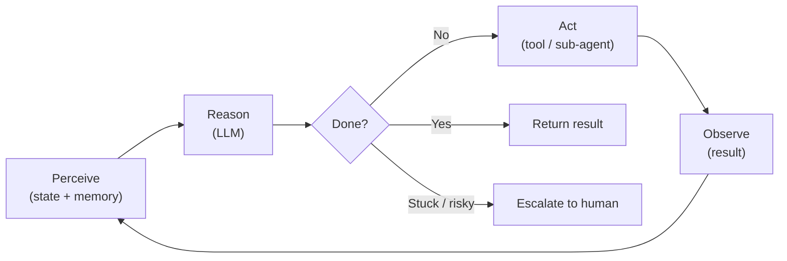

---

## Pattern Landscape

There are six pattern families. They compose: a real agent will often combine two or three.

| Family | Core idea | Typical use case |
|---|---|---|
| **Core loops** | How the agent reasons and acts within a single task | Tool-using assistants, code generation, research |
| **Prompt chaining** | Sequential LLM calls where output A becomes input B — not an agentic loop | ETL pipelines, document processing, multi-phase workflows |
| **Multi-agent** | Multiple agents with distinct roles, coordinated by an orchestrator | Complex analysis, parallel research, large-scale automation |
| **Memory** | How agents retain and recall information across actions | Long-horizon tasks, personalisation, codebase navigation |
| **Tool use** | How agents interact with external systems | CRUD operations, API calls, code execution |
| **Human-in-the-loop** | How agents hand off to humans and resume | Approval gates, escalation, audit-sensitive operations |

---

## Core Loop Patterns

These govern how a single agent reasons and acts.

### ReAct (Reason + Act)

The agent explicitly reasons before each action. Thought and action interleave:

```
Thought: I need to check the current deployment status.
Action: call_tool("get_deployment_status", {"service": "payments"})
Observation: {"status": "degraded", "since": "14:32 UTC"}
Thought: The service is degraded. I should check recent deployments.
Action: call_tool("list_recent_deployments", {"service": "payments", "limit": 5})
...
```

ReAct is the default starting point for most tool-using agents.

### Plan-Execute

The agent produces a structured plan before taking any action. Execution is a separate phase.

Separation allows:
- Human review of the plan before execution
- Parallelisation of independent plan steps
- Replanning if a step fails

### Reflection

The agent evaluates its own output and revises it. A critic (same or separate model) scores the output and provides structured feedback. The generator revises until quality criteria are met.

---

## Multi-Agent Patterns

These govern how multiple agents collaborate.

### Orchestrator / Worker

A central orchestrator decomposes the task and delegates to specialist workers. Workers return results; the orchestrator aggregates and decides what to do next. The orchestrator does not execute directly — it coordinates.

### Parallel (Fan-out / Fan-in)

Multiple agents run concurrently on independent subtasks. A synthesiser merges the results. Best for tasks with no data dependencies between subtasks.

---

## Prompt Chaining

Prompt chaining is **not** a multi-agent pattern. There is no agentic loop — each stage is a single, stateless LLM call. Output from one stage becomes the input to the next. The chain is deterministic and observable; each step can be tested independently.

It is the simpler predecessor to a multi-agent pipeline. When a stage needs memory, tools, or the ability to iterate, it becomes a full agent and the chain becomes a pipeline.

### Pipeline

Stages are arranged in a sequence. Each stage has a narrow, focused role. A stage can be a plain LLM call (prompt chain) or a full agent. Output flows downstream.

---

## Memory Patterns

Agents have three types of memory:

| Type | Lifetime | Location | Example |
|---|---|---|---|
| **In-context** | One interaction | Context window | Recent tool results, conversation history |
| **External** | Persistent | Vector store, key-value, database | Codebase knowledge, past decisions |
| **Episodic** | Session | Rolling buffer | Prior turns in a long conversation |

Context engineering (the companion series) governs what goes into in-context memory. This series focuses on how agents use and update all three.

---

## Tool Use

Tools ground agents in real-world state. Without tools, agents can only reason about what is in their context. With tools, they can read live data, execute code, call APIs, and persist results.

Every tool call is:
1. **Defined** — schema that tells the model what the tool does and what it expects
2. **Dispatched** — the agent's output triggers execution
3. **Observed** — the result is injected back into context for the next reasoning step

Tool errors are part of the loop. A well-designed agent handles tool failure by reasoning about it, not crashing.

---

## Human-in-the-Loop Patterns

Agents that operate autonomously on high-stakes tasks need human checkpoints. These are not failures of automation — they are designed control surfaces.

| Pattern | When to use |
|---|---|
| **Approval gate** | Before irreversible or high-risk actions |
| **Checkpoint review** | At natural phase boundaries (e.g. after planning, before execution) |
| **Escalation** | When the agent is stuck, uncertain, or detects a conflict it cannot resolve |

---

## Choosing a Pattern

Use this decision guide as a starting point. Patterns compose, so the right answer is often "start with the simplest and add complexity only when needed."

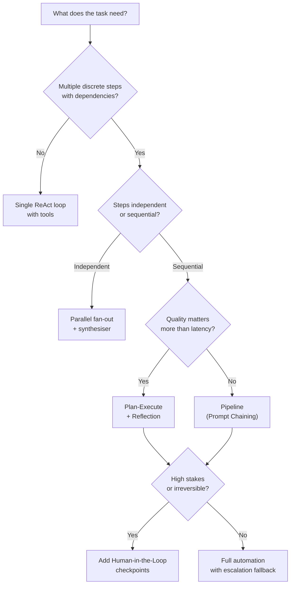

---

## Trade-offs

Every pattern has costs. Choose deliberately.

| Concern | Simpler pattern | More complex pattern |
|---|---|---|
| **Latency** | Lower (fewer round-trips) | Higher (more steps, more tool calls) |
| **Cost** | Lower (fewer tokens) | Higher (multi-agent = multiple LLM calls) |
| **Step-level recoverability** | Lower (single point of failure) | Higher (each step can be retried independently) — though overall system reliability may be lower due to more failure surfaces and coordination overhead |
| **Observability** | Harder (one big black box) | Easier (each step has inputs and outputs) |
| **Debuggability** | Harder | Easier |
| **Development cost** | Lower | Higher |

Start simple. Add complexity only when a simpler pattern provably cannot meet the requirement.

---

# Agentic Design Patterns Part 2: Core Loops

The three core loop patterns — ReAct, Plan-Execute, and Reflection — are the building blocks every other agentic pattern is composed from. Most agents are one of these, or a combination.

---

## ReAct (Reason + Act)

ReAct is the fundamental tool-using loop. The agent alternates between explicit reasoning steps (Thought) and actions (Action), incorporating the result of each action (Observation) before deciding what to do next.

### Structure

```
Thought:     I need to find the current on-call owner for the payments service.
Action:      call_tool("get_oncall", {"team": "payments"})
Observation: {"owner": "alice@example.com", "rotation": "weekly"}

Thought:     I have the owner. Now I need to check if there is an active incident.
Action:      call_tool("list_incidents", {"service": "payments", "status": "open"})
Observation: []

Thought:     No active incidents. I can proceed with the deployment notice.
Action:      call_tool("send_notification", {"to": "alice@example.com", "body": "..."})
Observation: {"sent": true}

Thought:     Done.
Answer:      Deployment notice sent to alice@example.com. No active incidents found.
```

The explicit Thought step is not decoration — it forces the model to reason about the result before acting again, which dramatically reduces errors on multi-step tasks.

The Thought step works by eliciting **chain-of-thought** (CoT) reasoning: asking the model to externalise its reasoning before committing to an action. CoT is a prompting technique, not an agentic pattern — it operates within a single LLM call. ReAct is what happens when you combine CoT with a tool-use loop. If you encounter references to CoT or "think step by step" prompting elsewhere, that is the mechanism this Thought step is built on. The [context engineering document](context-engineering.md) covers CoT and related prompting techniques in depth.

### When to use ReAct

- The task requires tool calls interleaved with reasoning
- The number of steps is not known in advance
- Tool results may change the direction of the task
- Simplest capable pattern is preferred

### When ReAct is not enough

- The task has a long fixed sequence of steps that benefit from upfront planning
- You need a human to review the plan before any action is taken
- Output quality requires self-evaluation before returning a result

### Go Implementation

```go
type Thought struct {
    Text   string
    Action *ToolCall // nil if this is the final thought
}

type ToolCall struct {
    Name   string
    Params map[string]any
}

type ToolResult struct {
    Name   string
    Output string
    Err    error
}

type ReActAgent struct {
    llm      LLMClient
    tools    ToolRegistry
    maxSteps int
}

func (a *ReActAgent) Run(ctx context.Context, task string) (string, error) {
    history := []Message{{Role: "user", Content: task}}

    for step := range a.maxSteps {
        thought, err := a.llm.Think(ctx, history)
        if err != nil {
            return "", fmt.Errorf("step %d: %w", step, err)
        }

        // No tool call means the agent has reached a conclusion.
        if thought.Action == nil {
            return thought.Text, nil
        }

        result := a.tools.Execute(ctx, *thought.Action)

        history = append(history,
            Message{Role: "assistant", Content: formatThought(thought)},
            Message{Role: "tool", Content: formatResult(result)},
        )
    }

    return "", errors.New("max steps reached without conclusion")
}
```

---

## Plan-Execute

Plan-Execute separates thinking from doing. A planner produces a structured, reviewable plan. An executor carries out each step. The two phases are distinct and can be run by different models.

### Structure

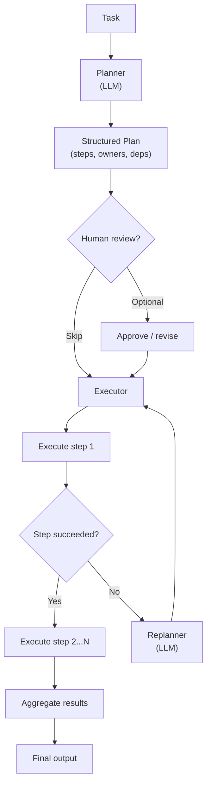

### When to use Plan-Execute

- The task has a clear sequence of steps that can be determined upfront
- Human review of the plan is required before execution begins
- Steps are expensive (time or cost) and should not be retried speculatively
- The executor is not an LLM (a script, a workflow engine, a human team)

### When Plan-Execute is not enough

- The task is exploratory and the next step depends on what is discovered
- The plan space is too large to enumerate upfront (use ReAct instead)
- The plan is very short — overhead is not justified

### Go Implementation

```go
type Plan struct {
    Goal  string
    Steps []PlanStep
}

type PlanStep struct {
    ID          string
    Description string
    Tool        string
    Params      map[string]any
    DependsOn   []string
}

type ExecutionResult struct {
    StepID string
    Output string
    Err    error
}

type PlanExecuteAgent struct {
    planner  LLMClient
    executor StepExecutor
}

func (a *PlanExecuteAgent) Run(ctx context.Context, task string) ([]ExecutionResult, error) {
    plan, err := a.planner.GeneratePlan(ctx, task)
    if err != nil {
        return nil, fmt.Errorf("planning: %w", err)
    }

    results := make([]ExecutionResult, 0, len(plan.Steps))
    completed := map[string]string{} // stepID → output

    for i := 0; i < len(plan.Steps); i++ {
        step := plan.Steps[i]

        if err := waitForDependencies(step.DependsOn, completed); err != nil {
            return results, fmt.Errorf("step %s: dependency failed: %w", step.ID, err)
        }

        result, err := a.executor.Execute(ctx, step, completed)
        if err != nil {
            // Attempt replanning for the remaining steps.
            revised, replannErr := a.planner.Replan(ctx, plan, step.ID, err)
            if replannErr != nil {
                return results, fmt.Errorf("step %s failed and replanning failed: %w", step.ID, err)
            }
            plan = revised
            i = 0
            continue
        }

        results = append(results, result)
        completed[step.ID] = result.Output
    }

    return results, nil
}
```

---

## Reflection

Reflection adds a quality gate. A generator produces output. A critic evaluates it against explicit criteria. The generator revises. The loop runs until quality criteria are met or a budget is exhausted.

### Structure

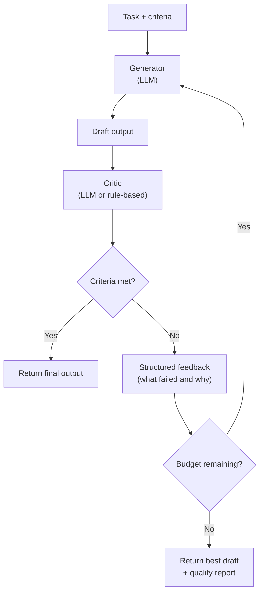

### Critic quality

The critic is only as good as its criteria. Vague criteria ("make it better") produce vague feedback and slow convergence. Explicit, testable criteria produce fast, targeted revisions.

Good criteria are:
- **Specific:** "The plan must include a rollback step for each database migration."
- **Verifiable:** "All referenced Jira issue keys must follow the pattern [A-Z]+-[0-9]+."
- **Prioritised:** Distinguish blocking failures from warnings.

### When to use Reflection

- Output quality has high variance and incorrect outputs are costly
- Quality criteria can be stated explicitly
- Latency budget allows multiple LLM calls
- Examples: code generation, security policy review, technical writing

### When Reflection is not enough

- Quality criteria cannot be stated explicitly — use human review instead
- Latency matters more than quality — accept the first draft
- The critic is the same model with no additional context — it will not catch its own blind spots (use a different model or rule-based checks for critical criteria)

### Go Implementation

```go
type QualityCriteria struct {
    MustPass   []CriterionFn // blocking: revision required if any fail
    ShouldPass []CriterionFn // advisory: included in feedback but not blocking
}

type CriterionFn func(output string) (pass bool, feedback string)

type ReflectionAgent struct {
    generator LLMClient
    critic    LLMClient
    criteria  QualityCriteria
    maxRounds int
}

type QualityReport struct {
    Passed    []string
    Failed    []string
    Warnings  []string
    Rounds    int
}

func (a *ReflectionAgent) Run(ctx context.Context, task string) (string, QualityReport, error) {
    report := QualityReport{}
    draft := ""

    // Tracks the failures from the previous round to pass to the generator.
    // Kept separate from report so the generator input and the live report fields
    // do not alias — report fields are always reset by a.criteria.Evaluate each round.
    var generatorFeedback []string

    for round := range a.maxRounds {
        report.Rounds = round + 1

        var err error
        draft, err = a.generator.Generate(ctx, task, draft, generatorFeedback)
        if err != nil {
            return "", report, fmt.Errorf("generation round %d: %w", round, err)
        }

        // Apply deterministic criteria first — fast and cheap.
        // Evaluate replaces (not appends to) all three fields, so report always
        // reflects only the current draft.
        report.Passed, report.Failed, report.Warnings = a.criteria.Evaluate(draft)
        if len(report.Failed) == 0 {
            return draft, report, nil
        }

        // Use the critic LLM for nuanced feedback when deterministic checks fail.
        if round < a.maxRounds-1 {
            feedback, err := a.critic.Critique(ctx, task, draft, report)
            if err != nil {
                return draft, report, fmt.Errorf("critique round %d: %w", round, err)
            }
            report.Failed = append(report.Failed, feedback.BlockingIssues...)
            report.Warnings = append(report.Warnings, feedback.AdvisoryIssues...)
        }

        // Snapshot the combined failures so the generator receives full context
        // from this round when it produces the next draft.
        generatorFeedback = report.Failed
    }

    // Return best effort draft with quality report.
    return draft, report, nil
}
```

---

## Composing the Three Patterns

These patterns are not mutually exclusive.

| Combination | When to use |
|---|---|
| ReAct + Reflection | Tool-using task where output quality matters (e.g. code generation with tests) |
| Plan-Execute + Reflection | Multi-step delivery plan that must meet explicit quality criteria before handoff |
| Plan-Execute + ReAct | Planning phase produces steps; each step is executed by a ReAct agent |
| All three | High-stakes, multi-step, quality-sensitive automation (use sparingly — high cost) |

The rule: add a pattern only when the simpler form demonstrably cannot meet the requirement. Unnecessary complexity increases latency, cost, and failure modes.

---

## Cost-Aware Loop Design

Cost should be treated as a first-class loop budget, like latency and reliability.

The practical model is two-layered:

- **Routing heuristic (primary):** choose the cheapest sufficient strategy for the current step.
- **Hard guardrails (safety):** enforce non-negotiable ceilings and fallback behavior.

### Step-level routing heuristic

Before each reasoning step, classify the work:

- Task complexity (low/medium/high)
- Risk tier (low/medium/high/critical)
- Reversibility (easy/hard)
- Tool confidence (high when deterministic tool path exists)
- Remaining budget (per-step and per-run)

Then route accordingly:

- Low complexity + high tool confidence: tool-first + small model for synthesis.
- Medium complexity: standard model with bounded iteration.
- High complexity or high-risk: stronger model, with explicit HITL checkpoints.

This avoids paying premium model cost for routine actions while preserving quality where it matters.

### Why not hard cap alone

A strict per-call cap without routing typically causes avoidable failures:

- Expensive-but-correct calls are blocked even when they minimize total task cost.
- Forced downgrades can increase retries and rework.
- Loop-level spend remains uncontrolled if many cheap calls accumulate.

### Why not heuristic alone

Heuristics drift and fail in edge cases. Hard ceilings prevent runaway spend when prompt growth, retries, or loops behave unexpectedly.

### Loop budget policies

Every loop should define and enforce:

- Maximum USD per step
- Maximum USD per run
- Maximum rounds/iterations
- Maximum retries per step

When a threshold is crossed, apply a deterministic fallback ladder:

1. Trim context and remove non-critical memory/tool traces.
2. Reduce loop depth (for example, fewer reflection rounds).
3. Route to a cheaper model.
4. Switch to tool-only or partial-result mode when possible.
5. Escalate to human review for high-impact unresolved tasks.

### Reflection-specific guidance

Reflection can improve quality but is a common cost amplifier. Default to bounded reflection:

- Start with deterministic checks first (cheap).
- Use one critique pass by default.
- Allow additional rounds only when quality criteria are blocking and budget remains.

### What to optimize

Optimize for **expected total task cost**, not just unit cost per LLM call. A more expensive model can be cheaper end-to-end if it reduces retries, invalid tool actions, and human rework.

# Agentic Design Patterns Part 3: Prompt Chaining

Prompt chaining is the practice of decomposing a complex task into a sequence of focused LLM calls, where the output of each step becomes the input to the next. Each step has a single, narrow responsibility. The structure is fixed at design time.

This article covers the linear chain, gate and routing patterns, and the tradeoffs that should guide when to reach for chaining over a full agentic loop.

---

## Why Prompt Chaining?

A single prompt that asks an LLM to extract, validate, enrich, and format a document in one pass will produce worse results than four focused prompts doing one thing each. There are three reasons:

1. **Attention dilution.** A monolithic prompt splits the model's attention across competing concerns. A focused prompt concentrates it on one.
2. **Composability.** Each step is independently testable and replaceable. You can swap a summarisation step for a better model without touching the rest of the chain.
3. **Observability.** Every intermediate result is inspectable. When something goes wrong, you know which step produced the bad output — not just that the final output is wrong.

Prompt chaining is not an agentic loop. The model does not decide what to do next. The structure of the chain is your decision, made at design time.

---

## The Linear Chain

The simplest form: output of step N flows directly into step N+1. No branching, no feedback, no loops.

### Structure

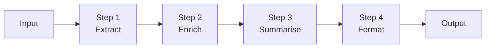

### Example: incident report enrichment

```
Input:       Raw alert payload from PagerDuty

Step 1 — Extract:
  Prompt:    "Extract the service name, error type, and first occurrence time from this alert."
  Output:    { "service": "payments", "error": "timeout", "since": "14:32 UTC" }

Step 2 — Enrich:
  Prompt:    "Given this incident, identify the on-call owner and the last deployment for the service."
  Tools:     get_oncall("payments"), list_deployments("payments", limit=1)
  Output:    { "owner": "alice@example.com", "last_deploy": "14:15 UTC by bob@example.com" }

Step 3 — Summarise:
  Prompt:    "Write a one-paragraph incident summary for a Slack post."
  Output:    "The payments service has been experiencing timeouts since 14:32 UTC..."

Step 4 — Format:
  Prompt:    "Format this summary as a Slack Block Kit message."
  Output:    { "blocks": [...] }
```

Each step sees only the output of the previous step plus a focused system prompt. No step needs to know about the full chain.

### When to use a linear chain

- The transformation sequence is known upfront and does not depend on intermediate results
- Each step has a clear input/output contract
- You want fully predictable, deterministic flow
- Output quality degrades when a single LLM handles all concerns at once

### When a linear chain is not enough

- The next step depends on the *meaning* of the previous result (use ReAct instead)
- Some steps should be skipped based on what is discovered (use routing, below)
- Steps need to share tool access across a reasoning loop (use a core loop pattern)

---

## Gates

A gate is a validation step between two chain stages. It evaluates whether the output of the previous step is fit to proceed. If not, the chain halts or routes to a fallback.

### Structure

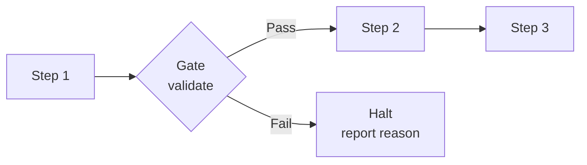

### Gate types

| Gate type | What it checks | Example |
|---|---|---|
| **Schema gate** | Output conforms to the expected structure | Step 1 extracted required fields |
| **Quality gate** | Output meets a quality threshold | Summary is coherent and on-topic |
| **Policy gate** | Output does not violate a rule | No PII in the formatted message |
| **Completeness gate** | Required information is present | All mandatory fields populated |

A gate does not need to be an LLM call. A schema gate is a JSON schema validation. A completeness gate is a field-presence check. Reserve LLM-based gates for quality or policy judgements that cannot be expressed as rules.

```go
type GateResult struct {
    Pass   bool
    Reason string // non-empty on failure, explains what was wrong
}

type Gate func(ctx context.Context, output string) GateResult

func SchemaGate(schema jsonschema.Schema) Gate {
    return func(_ context.Context, output string) GateResult {
        if err := schema.Validate(output); err != nil {
            return GateResult{Pass: false, Reason: err.Error()}
        }
        return GateResult{Pass: true}
    }
}

func LLMQualityGate(llm LLMClient, criteria string) Gate {
    return func(ctx context.Context, output string) GateResult {
        result, err := llm.Evaluate(ctx, output, criteria)
        if err != nil {
            return GateResult{Pass: false, Reason: err.Error() }
        }
        return GateResult{Pass: result.Score >= 0.8, Reason: result.Feedback}
    }
}
```

---

## Routing

A router reads the output of one step and selects which step to run next. Unlike a gate (pass/fail), a router chooses between two or more branches.

### Structure

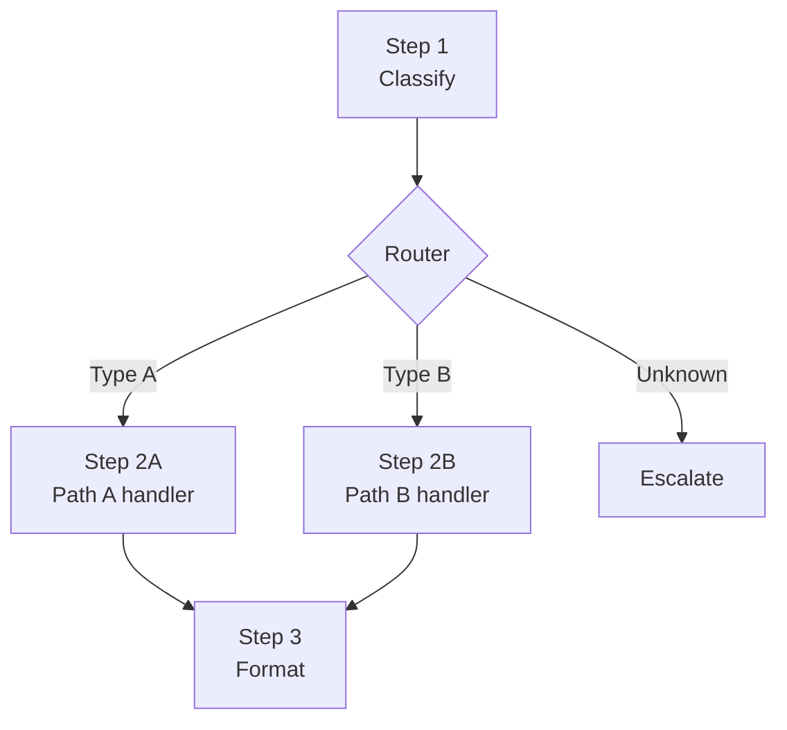

### Example: change request triage

```
Step 1 — Classify:
  Prompt:    "Classify this change request as: routine, expedited, or emergency."
  Output:    { "type": "expedited", "rationale": "..." }

Router:
  "expedited" → Step 2A: expedited approval workflow
  "emergency" → Step 2B: emergency CAB notification
  "routine"   → Step 2C: standard 5-day review queue
```

Routers are usually simple conditional logic over a structured output. Avoid using an LLM to route if a rule will do.

```go
type Router func(output string) (nextStage string, err error)

func ClassificationRouter(output string) (string, error) {
    var result struct {
        Type string `json:"type"`
    }
    if err := json.Unmarshal([]byte(output), &result); err != nil {
        return "", fmt.Errorf("router: invalid output: %w", err)
    }
    switch result.Type {
    case "expedited":
        return "expedited-handler", nil
    case "emergency":
        return "emergency-handler", nil
    case "routine":
        return "routine-handler", nil
    default:
        return "escalate", nil
    }
}
```

---

## Go Implementation

A minimal, composable pipeline:

```go
// Stage transforms a document, returning the enriched document or an error.
type Stage func(ctx context.Context, doc Document) (Document, error)

// Document is the common envelope passed between stages.
// Extend with domain-specific fields as needed.
type Document struct {
    Input     string
    Extracted map[string]any
    Enriched  map[string]any
    Output    string
    Metadata  map[string]any
}

type Pipeline struct {
    stages []Stage
}

func NewPipeline(stages ...Stage) *Pipeline {
    return &Pipeline{stages: stages}
}

func (p *Pipeline) Run(ctx context.Context, input string) (Document, error) {
    doc := Document{Input: input}

    for i, stage := range p.stages {
        var err error
        doc, err = stage(ctx, doc)
        if err != nil {
            return doc, fmt.Errorf("stage %d: %w", i, err)
        }
    }

    return doc, nil
}
```

Wrapping an LLM call as a stage:

```go
func LLMStage(llm LLMClient, systemPrompt string, inject func(Document) string) Stage {
    return func(ctx context.Context, doc Document) (Document, error) {
        userMessage := inject(doc)
        response, err := llm.Complete(ctx, systemPrompt, userMessage)
        if err != nil {
            return doc, err
        }
        doc.Output = response
        return doc, nil
    }
}
```

Wrapping a gate as a stage:

```go
func GateStage(gate Gate) Stage {
    return func(ctx context.Context, doc Document) (Document, error) {
        result := gate(ctx, doc.Output)
        if !result.Pass {
            return doc, fmt.Errorf("gate failed: %s", result.Reason)
        }
        return doc, nil
    }
}
```

A full chain composition:

```go
pipeline := NewPipeline(
    LLMStage(llm, extractSystemPrompt, func(d Document) string { return d.Input }),
    GateStage(SchemaGate(extractedSchema)),
    LLMStage(llm, enrichSystemPrompt, func(d Document) string { return d.Output }),
    LLMStage(llm, summariseSystemPrompt, func(d Document) string { return d.Output }),
    GateStage(LLMQualityGate(llm, "Is the summary coherent and factually consistent with the input?")),
    LLMStage(llm, formatSystemPrompt, func(d Document) string { return d.Output }),
)
```

---

## Prompt Chaining vs. the Other Patterns

| | Prompt Chaining | ReAct | Multi-Agent Pipeline |
|---|---|---|---|
| **Structure** | Fixed at design time | Emergent (model decides next step) | Fixed at design time |
| **Each stage** | Single LLM call | Interleaved thought + tool calls | Full agent with its own loop |
| **Tool access** | Optional, per-stage | Central to the loop | Per-agent |
| **Dynamic replanning** | No | Yes | No |
| **Cost** | Low (minimal tokens per step) | Medium | High (multiple agent loops) |
| **Predictability** | High | Low | High |
| **Best for** | Known, sequential transformations | Open-ended exploration | Complex stages each requiring multi-step reasoning |

Choose prompt chaining when you know the steps upfront and each step is a focused transformation. Reach for ReAct when the path is not known in advance. Reach for a multi-agent pipeline when each stage is complex enough to need its own reasoning loop.

---

## Common Failure Modes

**Error amplification.** A bad output from step 1 propagates through every subsequent step. Use schema gates and quality gates at critical transitions — not only at the end.

**Context loss.** Each step sees only what you explicitly pass to it. If step 3 needs something produced by step 1 but not passed by step 2, you must thread it through the document envelope. Design your `Document` struct around what each step needs, not what is convenient to produce.

**Over-chaining.** More steps is not always better. Every additional LLM call adds latency and cost. If steps 2 and 3 are always called together and share context naturally, merge them.

**Silent degradation.** Without gates, a low-quality intermediate result will silently produce a plausible-looking final output. Add an LLM quality gate at any step where correctness matters for everything downstream.

# Agentic Design Patterns Part 4: Multi-Agent Patterns

When a single agent is not enough — because the task is too broad, requires specialist knowledge, or benefits from parallel execution — multi-agent patterns distribute the work across a coordinated system.

This article covers three multi-agent patterns: Orchestrator/Worker, Parallel (Fan-out/Fan-in), and Critic/Verifier.

---

## Why Multiple Agents?

A single agent faces hard limits:

- **Context window:** A complex task requires more information than any single call can hold
- **Specialisation:** Different subtasks need different tools, models, or instructions
- **Parallelism:** Independent subtasks that run sequentially add latency without benefit
- **Failure isolation:** A failure in one part should not invalidate completed work

Multi-agent patterns solve these problems by decomposing work, assigning it to focused agents, and coordinating the results.

The cost is coordination overhead: more LLM calls, more failure surfaces, harder debugging. Adopt multi-agent only when a single agent demonstrably cannot do the job.

---

## Orchestrator / Worker

The orchestrator decomposes the task, assigns work to worker agents, and aggregates their results. Workers have a narrow scope and do not need to know about the broader task.

The orchestrator does not execute steps directly. It plans, delegates, monitors, and synthesises.

### Structure

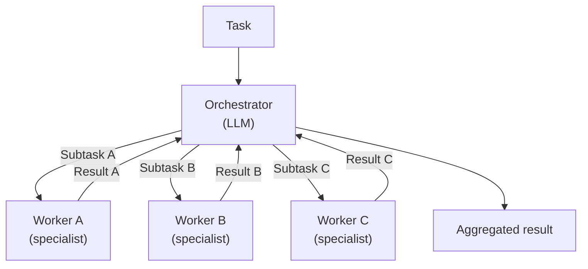

### When to use Orchestrator/Worker

- The task decomposes into well-defined, independent subtasks
- Each subtask benefits from a focused context (a worker sees only what it needs)
- Subtask results need synthesis or conflict resolution before the final answer
- Examples: multi-repo code review, incident root cause analysis, cross-team delivery planning

### Orchestrator responsibilities

1. Decompose the task into subtasks with clear, testable acceptance criteria
2. Select the right worker for each subtask (or parameterise a generic worker)
3. Detect when a worker result is incomplete or erroneous
4. Synthesise results, resolve conflicts, and produce a coherent output
5. Escalate if the task cannot be completed with available workers

### Go Implementation

```go
type Subtask struct {
    ID           string
    Description  string
    WorkerType   string
    Input        map[string]any
}

type WorkerResult struct {
    SubtaskID string
    Output    string
    Quality   float64 // 0–1 confidence score from the worker
    Err       error
}

type OrchestratorAgent struct {
    planner    LLMClient // decomposes task into subtasks
    workers    WorkerRegistry
    synthesiser LLMClient // merges worker results
}

func (a *OrchestratorAgent) Run(ctx context.Context, task string) (string, error) {
    subtasks, err := a.planner.Decompose(ctx, task)
    if err != nil {
        return "", fmt.Errorf("decomposition: %w", err)
    }

    results := a.runWorkers(ctx, subtasks)

    successful := filterSuccessful(results)
    if len(successful) == 0 {
        return "", errors.New("all workers failed")
    }

    return a.synthesiser.Synthesise(ctx, task, successful)
}

func (a *OrchestratorAgent) runWorkers(ctx context.Context, subtasks []Subtask) []WorkerResult {
    results := make([]WorkerResult, len(subtasks))
    var wg sync.WaitGroup

    for i, st := range subtasks {
        i, st := i, st
        wg.Add(1)
        go func() {
            defer wg.Done()
            worker, err := a.workers.Get(st.WorkerType)
            if err != nil {
                results[i] = WorkerResult{SubtaskID: st.ID, Err: fmt.Errorf("worker %s: %w", st.WorkerType, err)}
                return
            }
            result, err := worker.Execute(ctx, st)
            result.SubtaskID = st.ID
            result.Err = err
            results[i] = result
        }()
    }

    wg.Wait()
    return results
}
```

---

## Parallel (Fan-out / Fan-in)

Multiple independent agents run concurrently on different aspects of the same task. A synthesiser merges the results. Unlike Orchestrator/Worker, there is no ongoing coordination — agents run to completion independently.

### Structure

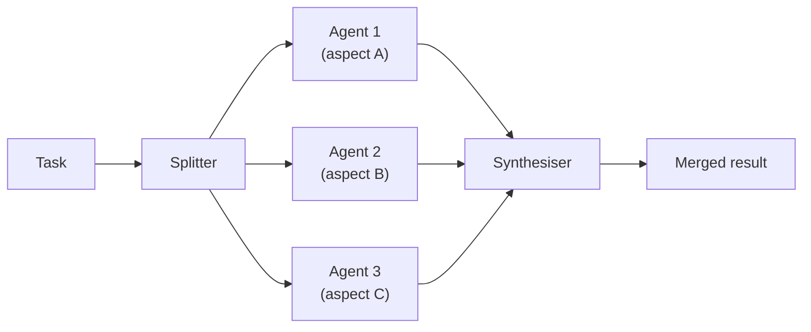

### When to use Parallel

- Subtasks have no data dependencies on each other
- The same question benefits from multiple independent perspectives (e.g. security review + performance review + correctness review of the same PR)
- Latency is critical and steps can be parallelised
- Results need to be merged, not just concatenated

### Difference from Orchestrator/Worker

| | Orchestrator/Worker | Parallel |
|---|---|---|
| Coordination | Ongoing (orchestrator monitors) | None (fire and gather) |
| Subtask discovery | Dynamic (orchestrator decides at runtime) | Static (splitter decides upfront) |
| Error handling | Orchestrator can replan | Synthesiser handles missing results |
| Complexity | Higher | Lower |

### Go Implementation

```go
type ParallelAgent struct {
    agents      []SpecialistAgent
    synthesiser LLMClient
}

type SpecialistAgent interface {
    Name() string
    Run(ctx context.Context, input string) (string, error)
}

type ParallelResult struct {
    AgentName string
    Output    string
    Err       error
}

func (a *ParallelAgent) Run(ctx context.Context, input string) (string, error) {
    results := make([]ParallelResult, len(a.agents))
    var wg sync.WaitGroup

    for i, agent := range a.agents {
        i, agent := i, agent
        wg.Add(1)
        go func() {
            defer wg.Done()
            output, err := agent.Run(ctx, input)
            results[i] = ParallelResult{AgentName: agent.Name(), Output: output, Err: err}
        }()
    }

    wg.Wait()

    // Synthesise, including any partial results if some agents failed.
    successful := filterSuccessful(results)
    if len(successful) == 0 {
        return "", errors.New("all parallel agents failed")
    }

    return a.synthesiser.Merge(ctx, input, successful)
}
```

---

## Critic / Verifier

A generator agent produces output. A separate verifier agent evaluates it against explicit criteria and returns a verdict: pass, revise, or reject. If the verdict is revise, the generator incorporates the feedback and tries again. The two agents are independent — they have separate contexts, can use different models, and can be developed and tested in isolation.

This is distinct from the Reflection pattern in core loops. Reflection is self-critique within a single agent's context. Critic/Verifier is a second agent with its own system prompt, its own specialisation, and optionally its own tools.

### Structure

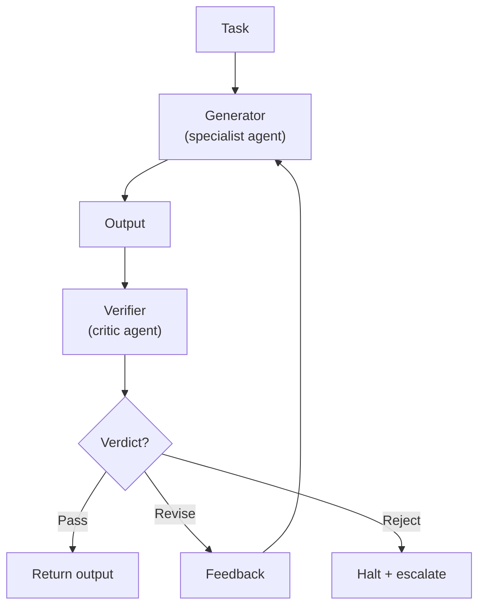

### When to use Critic/Verifier

- The generator and the reviewer require different expertise or tools (e.g. a code generator and a security reviewer)
- The quality criteria are explicit and can be encoded as a verifier system prompt
- You want the reviewer to be independently testable — including against known-bad outputs
- Self-critique (Reflection) has proven insufficient because the generator's blind spots are consistent
- Examples: code generation + policy compliance check, incident report + factual accuracy check against telemetry, architecture proposal + constraint validation

### Verdicts

The verifier returns one of three outcomes:

| Verdict | Meaning | Generator action |
|---|---|---|
| **Pass** | Output meets criteria | Return to caller |
| **Revise** | Output has fixable issues; feedback provided | Incorporate feedback and regenerate |
| **Reject** | Output cannot be salvaged | Halt; escalate to human or fail loudly |

A verifier that only returns pass/fail is half-built. Actionable feedback is what makes the revision loop useful.

### Go Implementation

```go
type Verdict struct {
    Status   VerdictStatus // Pass, Revise, Reject
    Feedback string        // empty on Pass; required on Revise; reason on Reject
    Score    float64       // 0–1, useful for logging and dashboards
}

type VerdictStatus int

const (
    VerdictPass   VerdictStatus = iota
    VerdictRevise               // fixable; feedback provided
    VerdictReject               // not fixable
)

type GeneratorAgent interface {
    Generate(ctx context.Context, task string) (string, error)
    Revise(ctx context.Context, task, previous, feedback string) (string, error)
}

type VerifierAgent interface {
    Verify(ctx context.Context, task, output string) (Verdict, error)
}

type CriticVerifierSystem struct {
    generator  GeneratorAgent
    verifier   VerifierAgent
    maxRetries int
}

func (s *CriticVerifierSystem) Run(ctx context.Context, task string) (string, error) {
    output, err := s.generator.Generate(ctx, task)
    if err != nil {
        return "", fmt.Errorf("generator: %w", err)
    }

    for attempt := range s.maxRetries {
        verdict, err := s.verifier.Verify(ctx, task, output)
        if err != nil {
            return "", fmt.Errorf("verifier attempt %d: %w", attempt, err)
        }

        switch verdict.Status {
        case VerdictPass:
            return output, nil
        case VerdictReject:
            return "", fmt.Errorf("output rejected: %s", verdict.Feedback)
        case VerdictRevise:
            output, err = s.generator.Revise(ctx, task, output, verdict.Feedback)
            if err != nil {
                return "", fmt.Errorf("revision attempt %d: %w", attempt, err)
            }
        }
    }

    return "", fmt.Errorf("output did not pass verification after %d attempts", s.maxRetries)
}
```

---

## Choosing Between the Patterns

| Question | Recommendation |
|---|---|
| Do subtasks depend on each other's results? | Orchestrator/Worker (dynamic coordination) |
| Are subtasks truly independent and running in parallel? | Parallel fan-out |
| Is the processing sequence fixed and steps are simple LLM calls? | Prompt Chaining |
| Do I need dynamic replanning if a step fails? | Orchestrator/Worker |
| Do I want multiple perspectives on the same input? | Parallel fan-out |
| Does the generator have consistent blind spots that need external review? | Critic/Verifier |
| Are the generator and reviewer genuinely different specialisations? | Critic/Verifier |

---

## Observability

Multi-agent systems are harder to debug than single agents. Make every boundary observable:

- Log each subtask assignment and result at the orchestrator
- Include agent name, input hash, output hash, and latency in every span
- Propagate trace context (e.g. OpenTelemetry) from the root task through every agent call
- Emit a structured event when an agent fails, retries, or escalates

Without this, a failure deep in a worker is invisible at the surface.

```go
func (a *OrchestratorAgent) runWithTrace(ctx context.Context, st Subtask) (WorkerResult, error) {
    ctx, span := tracer.Start(ctx, "agent.worker",
        trace.WithAttributes(
            attribute.String("subtask.id", st.ID),
            attribute.String("worker.type", st.WorkerType),
        ),
    )
    defer span.End()

    result, err := a.workers.Get(st.WorkerType).Execute(ctx, st)
    if err != nil {
        span.RecordError(err)
        span.SetStatus(codes.Error, err.Error())
    }

    return result, err
}
```

# Agentic Design Patterns Part 5: Memory

Agents that can only reason about what is in their current context window are severely limited. Memory extends agents across time: it lets them accumulate knowledge within a session, recall prior experience across sessions, and share state with other agents.

---

## Memory Type Overview

Memory is not a single thing. Agents have three distinct memory types, each with different characteristics and different management requirements.

| Type | Lifetime | Storage | Cost to access | Example |
|---|---|---|---|---|
| **In-context** | One interaction | Context window | Zero (already loaded) | Recent tool results, conversation history |
| **External** | Persistent | Vector store, database, key-value | One retrieval call | Codebase knowledge, past decisions, user preferences |
| **Episodic** | Session | Rolling buffer | Low (summarisation or truncation) | Prior turns in a long multi-turn conversation |

These compose. A long-running agent might load episodic history into context at session start, retrieve relevant external facts on demand, and accumulate tool results as in-context memory during execution.

---

## In-Context Memory

Everything currently in the context window is in-context memory. It is free to access but finite and temporary.

**Management rules:**

1. Treat in-context memory as a budget, not a dump (see [Context Engineering](context-engineering.md))
2. Prioritise recent tool results over older ones when trimming
3. Summarise completed reasoning chains rather than retaining the full trace
4. Do not repeat the same information under multiple headings — deduplication saves tokens

**In-context memory decay:**

As an agent accumulates tool results over many steps, the context fills. The oldest, least-relevant material should be compressed or dropped first. Never silently drop constraints, criteria, or the original task definition — these must persist for the full interaction.

```go
type ContextManager struct {
    budget    int
    messages  []Message
    protected []string // content that must never be trimmed
}

func (m *ContextManager) Add(msg Message) {
    m.messages = append(m.messages, msg)
    for m.tokenCount() > m.budget {
        if !m.evictOldest() {
            break // all remaining messages are protected; cannot free further tokens
        }
    }
}

// evictOldest removes the oldest unprotected message and returns true.
// Returns false if all messages are protected and nothing could be evicted.
func (m *ContextManager) evictOldest() bool {
    for i, msg := range m.messages {
        if !m.isProtected(msg) {
            m.messages = slices.Delete(m.messages, i, i+1)
            return true
        }
    }
    return false
}
```

**Priority-weighted eviction:**

Not all messages are equally valuable. Assign priority scores so that high-value observations (rare data, decisions made, errors encountered) survive longer than low-value filler (intermediate reasoning steps, redundant confirmations).

```go
type ScoredMessage struct {
    Message  Message
    Priority int    // higher = more likely to survive eviction
    TokenLen int
}

func (m *ContextManager) evictLowestPriority() {
    lowest := 0

    if len(m.scored) == 0 {
        return
    
    }

    for i := 1; i < len(m.scored); i++ {
        if m.scored[i].Priority < m.scored[lowest].Priority {
            lowest = i
        }
    }
    m.scored = slices.Delete(m.scored, lowest, lowest+1)
}
```

---

## External Memory

External memory stores knowledge outside the context window and retrieves it on demand. The two primary forms are:

**Semantic retrieval (vector store):**
Store chunks of knowledge as embeddings. At query time, retrieve the top-k most semantically relevant chunks. Best for unstructured knowledge: documents, code, meeting transcripts.

**Structured retrieval (database / key-value):**
Store structured facts keyed by ID or query. At query time, look up exact facts. Best for precise, structured data: configuration, prior decisions, user records.

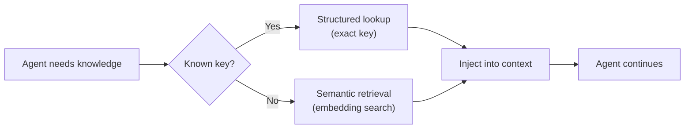

**Retrieval as a tool:**

Treat external memory retrieval as a tool call. This makes memory access explicit, observable, and controllable. The agent reasons about what it needs and requests it — rather than having a retrieval layer guess.

```go
type MemoryTool struct {
    vectorStore  VectorStore
    structuredDB StructuredDB
}

func (m *MemoryTool) Definition() ToolDefinition {
    return ToolDefinition{
        Name:        "retrieve_knowledge",
        Description: "Retrieve relevant knowledge from the knowledge base. Use when you need information that is not in your current context.",
        Parameters: map[string]ParameterDef{
            "query":  {Type: "string", Description: "What you want to know"},
            "kind":   {Type: "string", Enum: []string{"semantic", "exact"}, Description: "semantic for open-ended queries, exact for known IDs"},
            "key":    {Type: "string", Description: "Required for kind=exact: the exact key to look up"},
            "limit":  {Type: "integer", Description: "Maximum number of results to return (default 5)"},
        },
    }
}

func (m *MemoryTool) Execute(ctx context.Context, params map[string]any) (string, error) {
    kind, _ := params["kind"].(string)

    switch kind {
    case "exact":
        key, ok := params["key"].(string)
        if !ok || key == "" {
            return "", fmt.Errorf("kind=exact requires a non-empty 'key' parameter")
        }
        return m.structuredDB.Get(ctx, key)
    default:
        query, _ := params["query"].(string)
        // JSON unmarshalling into map[string]any produces float64 for numbers,
        // not int — so assert to float64 first.
        var limit int
        if f, ok := params["limit"].(float64); ok {
            limit = int(f)
        }
        if limit == 0 {
            limit = 5
        }
        chunks, err := m.vectorStore.Search(ctx, query, limit)
        if err != nil {
            return "", err
        }
        return formatChunks(chunks), nil
    }
}
```

### Memory write-back

Read-only retrieval is not enough for agents that discover or generate knowledge during execution. An agent that investigates an incident, finds the root cause, and writes it back creates a persistent record that future agents (or future runs of the same agent) can build on.

Write-back requires discipline: write only facts, decisions, and conclusions — not raw reasoning traces. Raw traces are verbose, stale quickly, and pollute retrieval results.

```go
func (m *MemoryTool) WriteDefinition() ToolDefinition {
    return ToolDefinition{
        Name:        "store_knowledge",
        Description: "Persist a fact, decision, or conclusion to the knowledge base for future use. Only call this for information that will be useful in future sessions or to other agents. Do not write intermediate reasoning.",
        Parameters: map[string]ParameterDef{
            "key":     {Type: "string", Description: "A stable, descriptive key (e.g. 'incident/PAY-2024-11-incident-root-cause')"},
            "content": {Type: "string", Description: "The fact or conclusion to store"},
            "kind":    {Type: "string", Enum: []string{"fact", "decision", "reference"}, Description: "Type of knowledge"},
        },
    }
}
```

### Memory invalidation

External memory goes stale. A fact that was true six months ago may be dangerously wrong today. Two strategies:

| Strategy | Mechanism | Best for |
|---|---|---|
| **TTL** | Every record has an expiry timestamp; expired records are excluded from retrieval | Volatile facts (deployment versions, on-call rosters) |
| **Explicit invalidation** | An agent or process marks records as superseded when the underlying truth changes | Decisions and policies that change deliberately |

Always include a `stored_at` timestamp in memory records. Agents should be aware of age when using retrieved facts, especially for operational data.

---

## Episodic Memory

Episodic memory is a rolling record of recent session history. It gives long-running conversational agents a sense of continuity across turns without injecting the entire conversation into every call.

**Management approaches:**

| Approach | Mechanism | Trade-off |
|---|---|---|
| **Fixed window** | Keep the last N turns verbatim | Simple; may lose important context |
| **Summary** | Periodically summarise older turns | Preserves meaning; adds latency |
| **Selective** | Keep turns that were flagged as important | High fidelity; requires explicit flagging |
| **Hybrid** | Full recent turns + summary of older turns | Best quality; most complex |

```go
type EpisodicMemory struct {
    recentTurns    []Turn       // verbatim, kept as-is
    historySummary string       // compressed summary of older turns
    summariser     LLMClient
    windowSize     int          // max turns to keep verbatim
}

func (e *EpisodicMemory) AddTurn(ctx context.Context, t Turn) error {
    e.recentTurns = append(e.recentTurns, t)

    if len(e.recentTurns) > e.windowSize {
        // Compress the oldest turn into the running summary.
        oldest := e.recentTurns[0]
        e.recentTurns = e.recentTurns[1:]

        var err error
        e.historySummary, err = e.summariser.UpdateSummary(ctx, e.historySummary, oldest)
        if err != nil {
            return fmt.Errorf("episodic compression: %w", err)
        }
    }

    return nil
}

func (e *EpisodicMemory) ToMessages() []Message {
    msgs := []Message{}
    if e.historySummary != "" {
        msgs = append(msgs, Message{
            Role:    "system",
            Content: "Prior conversation summary:\n" + e.historySummary,
        })
    }
    for _, t := range e.recentTurns {
        msgs = append(msgs, t.ToMessages()...)
    }
    return msgs
}
```

---

## Shared Memory in Multi-Agent Systems

Single-agent memory is private by default. In multi-agent systems, agents often need to share state: a researcher agent's findings should be visible to the writer agent; a monitor agent's alerts should be visible to the responder.

Two sharing models:

**Blackboard model:** All agents read from and write to a shared store. No agent owns the state. Simple to implement; can cause contention.

**Message-passing model:** Agents pass memory payloads explicitly in their handoff messages. The receiving agent decides what to load into its own context. Higher control; more boilerplate.

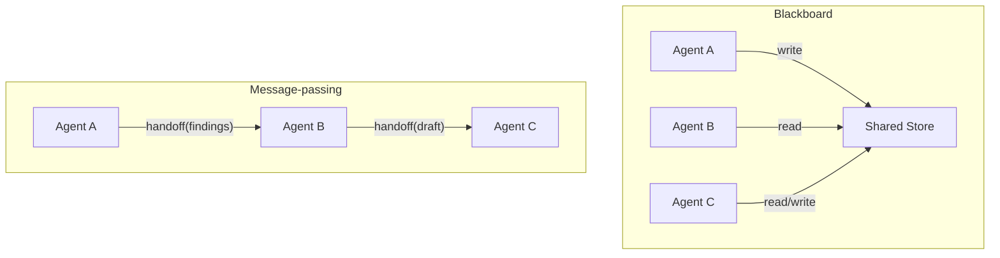

**Namespace isolation:** When multiple agents write to the same store, use namespaced keys to prevent collisions and to make attribution clear.

```go
type AgentMemory struct {
    store     KVStore
    agentID   string
    namespace string
}

func (m *AgentMemory) Write(ctx context.Context, key, value string) error {
    fullKey := fmt.Sprintf("%s/%s/%s", m.namespace, m.agentID, key)
    return m.store.Set(ctx, fullKey, value)
}

func (m *AgentMemory) ReadFrom(ctx context.Context, otherAgentID, key string) (string, error) {
    fullKey := fmt.Sprintf("%s/%s/%s", m.namespace, otherAgentID, key)
    return m.store.Get(ctx, fullKey)
}
```

---

## Putting It Together

A mature agent uses all three memory types in combination:

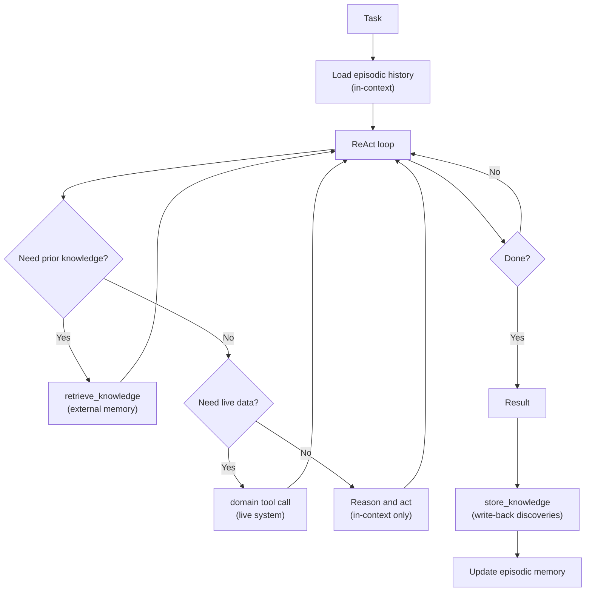

The key principle: memory and tool results are both observations. Whether the agent calls `retrieve_knowledge` or `get_deployment_status`, the result is the same — new information enters the context and the agent reasons about it.

---

# Agentic Design Patterns Part 6: Tool Use

Tools ground agents in real-world state. Without tools, agents can only reason about what is in their context. With tools, they can read live data, execute code, call APIs, write to systems, and trigger workflows.

---

## Tool Lifecycle

Every tool interaction has four phases:

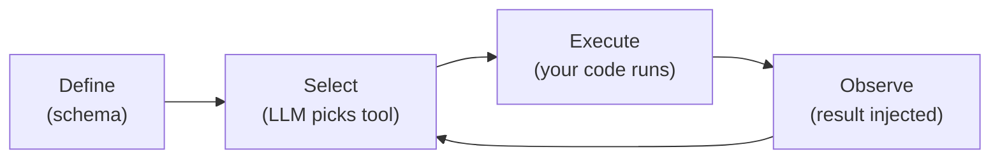

1. **Define** — a schema tells the model what the tool does, what it expects, and what it returns
2. **Select** — the model decides whether to call the tool, and with what parameters
3. **Execute** — your code runs; the model is not involved in this step
4. **Observe** — the result is injected into context as the next input to the reasoning step

Tool errors are part of the loop. A well-designed agent handles tool failure by reasoning about it, not crashing.

---

## Tool Design Principles

Before writing the schema, design the tool itself. A bad tool is worse than no tool — it gives the model a false sense of capability and produces unpredictable results.

**Each tool should do one thing.** A tool named `manage_deployment` that can create, update, and delete is hard for the model to reason about correctly. Separate tools with clear, distinct names are better.

**Distinguish read from write.** Read tools are safe to retry. Write tools have side effects. Make this distinction explicit in the tool name and description. The model uses this to reason about risk.

**Design for idempotency where possible.** If the agent calls a write tool twice (e.g. after a timeout it cannot confirm), the second call should not produce a second side effect. Idempotent tools can always be retried safely.

**Scope permissions tightly.** A tool that can write to any record is riskier than a tool scoped to the current task's resources. Pass in the narrowest scope your tool needs.

| Principle | Risky | Safe |
|---|---|---|
| Scope | `update_any_record(id, data)` | `update_my_record(data)` where agent ID is bound at construction |
| Side effects | `deploy(service, env)` — fires immediately | `plan_deploy(service, env)` + `apply_deploy(plan_id)` |
| Idempotency | `create_ticket(...)` — creates a new one every call | `create_or_get_ticket(idempotency_key, ...)` |

---

## Tool Definition

The definition is what the LLM reads to decide whether and how to use the tool. Poor definitions lead to wrong tool selection, wrong parameters, and wrong expectations about outputs.

**Good tool definition:**
- One sentence description that says what the tool does (not how it works)
- Parameters described from the agent's perspective — what the agent provides, not what the implementation receives
- Return value described, including error cases
- Guidance on when to use and when not to use

```go
type ToolDefinition struct {
    Name        string
    Description string
    Parameters  map[string]ParameterDef
    Returns     string
}

var getDeploymentStatusTool = ToolDefinition{
    Name:        "get_deployment_status",
    Description: "Returns the current deployment status of a service in a given environment. Use this to check whether a service is healthy, degraded, or rolled back before taking deployment actions. Do not use this to check service configuration — use get_service_config for that.",
    Parameters: map[string]ParameterDef{
        "service":     {Type: "string", Required: true, Description: "The service name as it appears in the deploy manifest"},
        "environment": {Type: "string", Required: true, Enum: []string{"dev", "int", "prod"}, Description: "The target environment"},
    },
    Returns: "JSON: {status: healthy|degraded|rollback, version: string, since: timestamp, owner: team name}",
}
```

**Common definition mistakes:**

| Mistake | Impact |
|---|---|
| Vague description ("does stuff with deployments") | Wrong tool selected |
| Implementation detail in description ("calls the K8s API") | Irrelevant noise; no benefit |
| Missing `when not to use` guidance | Model uses the wrong tool for related tasks |
| No description of the return shape | Model misinterprets the output |

---

## Tool Error Handling

Tool errors are observations, not crashes. The agent should reason about a tool error and decide whether to retry, use a different tool, or escalate.

```go
type ToolResult struct {
    Output string
    Err    error
}

func (r ToolResult) ToObservation() string {
    if r.Err != nil {
        // Structured error observation — gives the agent enough context to reason about it.
        return fmt.Sprintf(`{"error": %q, "recoverable": %v}`,
            r.Err.Error(), isRecoverable(r.Err))
    }
    return r.Output
}
```

Do not return raw stack traces in tool observations. They consume tokens, confuse the model, and may expose sensitive information. Return a clean, structured error that tells the agent what failed and whether it can recover.

**Error taxonomy:**

| Error type | `recoverable` | Agent response |
|---|---|---|
| Transient (timeout, 503) | `true` | Retry with backoff |
| Bad input (validation, 400) | `true` | Revise parameters and retry |
| Not found (404) | `true` | Try a different lookup strategy |
| Auth failure (403) | `false` | Escalate to human |
| Unexpected (500, panic) | `false` | Escalate; do not retry blindly |

---

## Tool Registry

Agents with many tools benefit from a registry that supports dynamic selection, access control, and observability.

```go
type ToolRegistry struct {
    tools map[string]Tool
}

func (r *ToolRegistry) Execute(ctx context.Context, call ToolCall) ToolResult {
    tool, ok := r.tools[call.Name]
    if !ok {
        return ToolResult{Err: fmt.Errorf("unknown tool: %s", call.Name)}
    }

    ctx, span := tracer.Start(ctx, "tool.execute",
        trace.WithAttributes(attribute.String("tool.name", call.Name)),
    )
    defer span.End()

    output, err := tool.Execute(ctx, call.Params)
    if err != nil {
        span.RecordError(err)
    }
    return ToolResult{Output: output, Err: err}
}
```

**What the registry owns:**
- Dispatch (route call name to implementation)
- Observability (trace every tool call)
- Access control (check whether the current agent role may call this tool)
- Rate limiting (prevent runaway agents from hammering downstream systems)

The registry should not own business logic. Keep tools thin: validate input, call a service, format the output.

---

## Tool Selection Strategies

As tool catalogs grow, exposing every tool to every reasoning step becomes inefficient and degrades selection quality.

**Expose all tools:** Simple. Works when the tool count is small (under 10). The model selects from the full set each step.

**Contextual filtering:** At each step, filter available tools based on the current phase or agent role. A planning agent should not see write tools. An execution agent does not need research tools.

```go
type Phase string

const (
    PhasePlan    Phase = "plan"
    PhaseExecute Phase = "execute"
    PhaseReview  Phase = "review"
)

func (r *ToolRegistry) ForPhase(phase Phase) []ToolDefinition {
    var result []ToolDefinition
    for _, t := range r.tools {
        if t.AllowedIn(phase) {
            result = append(result, t.Definition())
        }
    }
    return result
}
```

**Dynamic retrieval:** Treat tool definitions like external memory — retrieve the most relevant definitions for the current thought using semantic search. Scales to large catalogs (hundreds of tools) without degrading selection quality.

```go
type DynamicToolSelector struct {
    vectorStore ToolVectorStore
}

func (s *DynamicToolSelector) SelectFor(ctx context.Context, thought string, limit int) ([]ToolDefinition, error) {
    return s.vectorStore.SearchDefinitions(ctx, thought, limit)
}
```

---

## Parallel Tool Calling

Modern LLM APIs support requesting multiple tool calls in a single response. When the agent's reasoning identifies independent actions, it can dispatch them in parallel rather than sequentially.

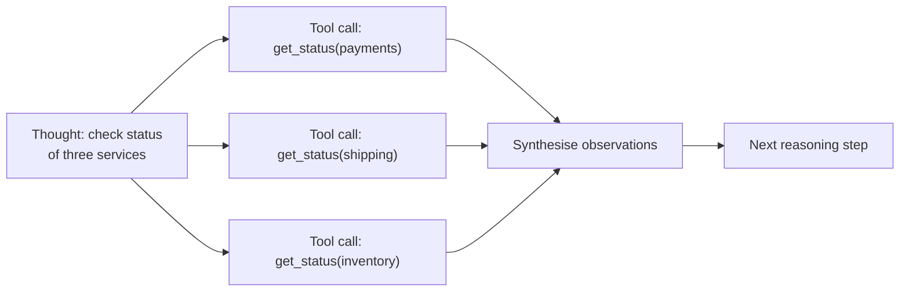

Parallel calls reduce latency significantly for fan-out queries. The trade-off: if one call fails, you need to decide whether to proceed with partial results or wait and retry.

```go
type ParallelDispatcher struct {
    registry *ToolRegistry
}

func (d *ParallelDispatcher) Execute(ctx context.Context, calls []ToolCall) []ToolResult {
    results := make([]ToolResult, len(calls))
    var wg sync.WaitGroup

    for i, call := range calls {
        wg.Add(1)
        go func(i int, call ToolCall) {
            defer wg.Done()
            results[i] = d.registry.Execute(ctx, call)
        }(i, call)
    }

    wg.Wait()
    return results
}
```

**When not to parallelise:** If tool B depends on tool A's output, they must be sequential. Parallelising dependent calls is a common source of agent bugs.

---

## Tool Result Caching

The same tool may be called multiple times in a single agent run with identical parameters. Caching avoids redundant calls to downstream systems, reduces latency, and prevents rate-limit exhaustion.

Cache at the tool call level, not the agent level. Key on `(tool_name, canonical_params)`.

```go
type CachedTool struct {
    inner   Tool
    cache   map[string]CacheEntry
    ttl     time.Duration
}

type CacheEntry struct {
    Result    ToolResult
    ExpiresAt time.Time
}

func (c *CachedTool) Execute(ctx context.Context, params map[string]any) (string, error) {
    key := cacheKey(c.inner.Name(), params)

    if entry, ok := c.cache[key]; ok && time.Now().Before(entry.ExpiresAt) {
        return entry.Result.Output, entry.Result.Err
    }

    output, err := c.inner.Execute(ctx, params)
    // Only cache successful results. Caching errors would prevent transient
    // failures (timeouts, 503s) from being retried — contradicting the error
    // taxonomy above. Let errors fall through so the next call retries live.
    if err == nil {
        c.cache[key] = CacheEntry{
            Result:    ToolResult{Output: output},
            ExpiresAt: time.Now().Add(c.ttl),
        }
    }
    return output, err
}
```

Only cache read tools. Write tools must never be cached — a cached write silently skips the actual operation.

---

## Model Context Protocol (MCP)

MCP is an open standard for connecting LLM agents to tools and data sources. Rather than each team writing bespoke tool implementations for each agent, MCP defines a common interface: a server exposes tools, resources, and prompts; a client (the agent runtime) connects and discovers them dynamically.

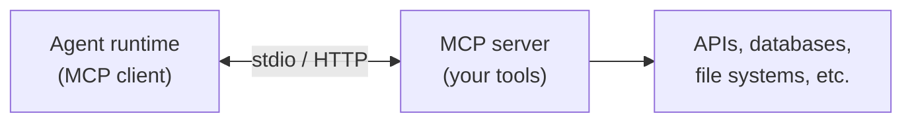

**Why it matters:**

- **Reuse:** One MCP server can serve multiple agents and tools without per-integration code
- **Discovery:** The agent queries the server for available tools at runtime — no hardcoded tool lists
- **Composability:** Multiple MCP servers can be connected to a single agent session

**When to use a custom MCP server:**

- You have a collection of domain tools that multiple agents or teams need
- You want to expose an internal API or platform capability to AI agents without building a per-agent integration
- You need to version tool contracts independently of agent deployments

---

## Cost-Aware Tool and Model Routing

Tool design and model selection should minimize total task cost, not just per-call cost.

### Preferred execution order

For most operational agents, use this order by default:

1. Deterministic read tools (fetch facts first)
2. Rule-based transforms/validation where possible
3. LLM synthesis over bounded evidence
4. High-reasoning model only for steps that need it

This pattern keeps expensive reasoning focused on ambiguity, not data retrieval.

### Model tiering by action type

- **Small model:** classification, extraction, short summaries, parameter normalization.
- **Standard model:** multi-source synthesis, moderate planning, constrained critique.
- **High-reasoning model:** complex conflict resolution, high-risk decisions, low-tolerance correctness tasks.

Avoid static model assignment for the whole run when step complexity changes.

### Cost-aware tool selection

When multiple tools can answer a question, prefer the path with:

- Lower token expansion risk
- Lower latency variance
- Higher determinism

Practical examples:

- Prefer `get_issue(id)` over `search_issues(query)` when ID is known.
- Prefer scoped project queries over global scans.
- Prefer cached read results in the same run when freshness permits.

### Budget metadata in observations

Inject budget state into the loop so the model can reason about trade-offs:

```json
{
    "budget": {
        "stepUsdRemaining": 0.03,
        "runUsdRemaining": 1.42,
        "policy": "default_cost_guardrails"
    }
}
```

Do not rely on model self-control alone; runtime must still enforce hard limits.

### Fallback ladder for tool-heavy loops

On predicted or actual budget breach:

1. Narrow tool scope (fewer records, tighter filters).
2. Reduce context payload (truncate non-critical evidence).
3. Downgrade model tier for non-critical steps.
4. Return partial answer with explicit coverage boundaries.
5. Escalate to human for unresolved high-impact actions.

A consistent fallback ladder makes behavior predictable and auditable.

---

# Agentic Design Patterns Part 7: Human-in-the-Loop

Autonomous agents make mistakes. On low-stakes, reversible tasks that is acceptable — the cost of a wrong action is low and the agent can self-correct. On high-stakes, irreversible, or audit-sensitive tasks, mistakes are not acceptable and self-correction is not sufficient.

Human-in-the-loop (HITL) patterns define the control surfaces through which humans review, approve, redirect, and audit agent behaviour.

---

## Why Pure Automation Fails on High-Stakes Tasks

An autonomous agent that never pauses for human input has no mechanism to catch:

- Actions that are technically correct but wrong for the business context
- Scenarios where the agent's confidence is high but its information is stale
- Irreversible side effects (production changes, financial transactions, customer communications)
- Cases where policy requires human accountability, not just system automation

HITL patterns are not a sign of weak AI. They are a deliberate engineering choice to place accountability where it belongs.

---

## Risk-Based Gating

Not every action needs human review. Classify actions by impact and reversibility before deciding which patterns to apply.

| Risk tier | Description | HITL requirement |
|---|---|---|
| **Low** | Reversible, no external effect (e.g. draft a document) | None — escalation fallback only |
| **Medium** | Reversible external effect, bounded blast radius (e.g. open a PR, post a Slack message) | Optional checkpoint |
| **High** | Irreversible or broad impact (e.g. merge to main, deploy to prod, send email blast) | Mandatory approval gate |
| **Critical** | Compliance-required, financial, or regulatory (e.g. change RBAC policy, process payment) | Mandatory approval gate + audit log |

Assign a risk tier to every tool the agent can call. The tier determines which HITL pattern applies.

---

## Pattern 1: Approval Gate

The agent halts before a high-risk action and waits for explicit human approval. The agent does not proceed until it receives a signal.

### Structure

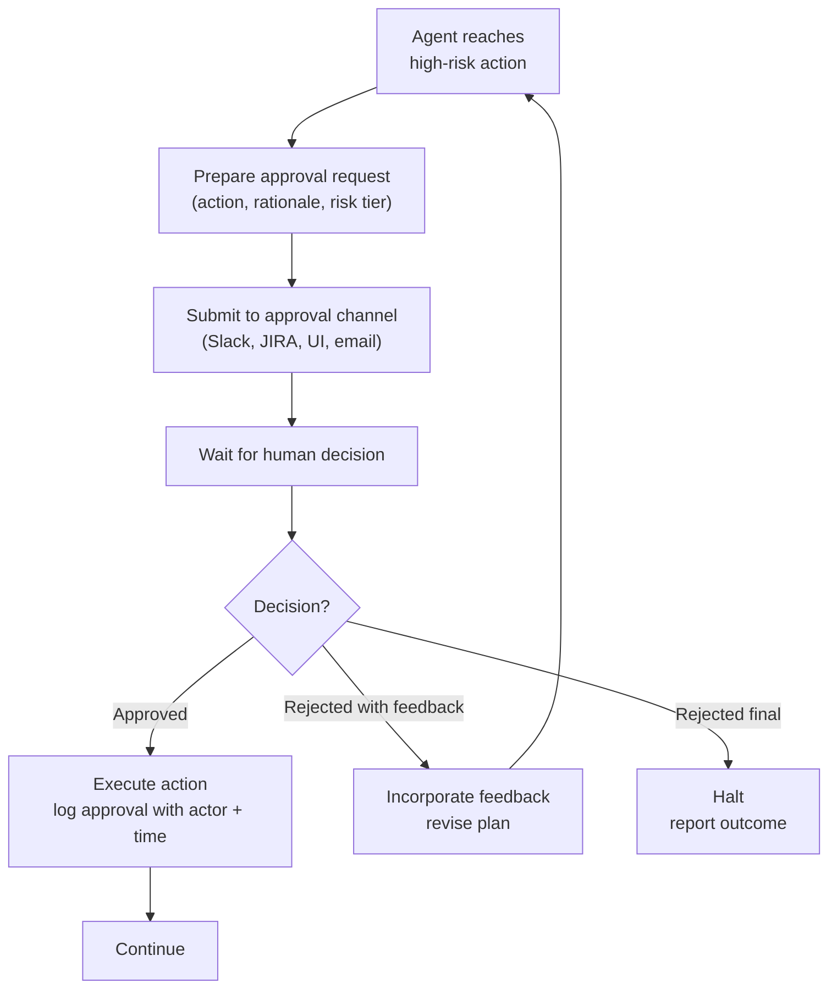

### What the approval request must include

The agent must give the reviewer enough context to make a real decision — not just "approve/reject" on an opaque action.

A good approval request contains:
- **What** the agent wants to do (the exact action and parameters)
- **Why** — the reasoning chain that led to this action
- **What happens if approved** — expected outcome and side effects
- **What happens if rejected** — alternative paths
- **Risk tier** — so the reviewer understands the stakes
- **Deadline** — if the decision must be made within a time window

```go
type ApprovalRequest struct {
    ID          string
    AgentID     string
    Action      ToolCall
    Rationale   string // the reasoning that led here
    Outcome     string // expected result if approved
    Alternatives []string // other paths if rejected
    RiskTier    RiskTier
    ExpiresAt   time.Time
}

type ApprovalGate struct {
    channel ApprovalChannel // Slack, Jira, webhook, database
    timeout time.Duration
}

func (g *ApprovalGate) RequestApproval(ctx context.Context, req ApprovalRequest) (ApprovalDecision, error) {
    if err := g.channel.Submit(ctx, req); err != nil {
        return ApprovalDecision{}, fmt.Errorf("submitting approval: %w", err)
    }

    ctx, cancel := context.WithTimeout(ctx, g.timeout)
    defer cancel()

    decision, err := g.channel.Wait(ctx, req.ID)
    if err != nil {
        if errors.Is(err, context.DeadlineExceeded) {
            return ApprovalDecision{}, ErrApprovalTimeout
        }
        return ApprovalDecision{}, err
    }

    return decision, nil
}
```

### Approval timeout handling

When a decision does not arrive within the timeout:

- **Safe default:** halt the agent and report the timeout. Do not proceed.
- **Escalation:** notify a secondary approver.
- **Auto-approve:** only for low-risk actions where the timer expiry itself is a business signal (use sparingly and document explicitly).

---

## Pattern 2: Checkpoint Review

The agent pauses at natural phase boundaries and presents a summary for review before moving to the next phase. This is less granular than approval gating on individual actions — it reviews a phase outcome, not a single step.

Checkpoint review is appropriate when:
- Each phase produces a reviewable artefact (a plan, a report, a draft)
- The reviewer needs to see the whole picture, not individual tool calls
- The cost of the next phase is high and should not be incurred on a flawed foundation

### Structure

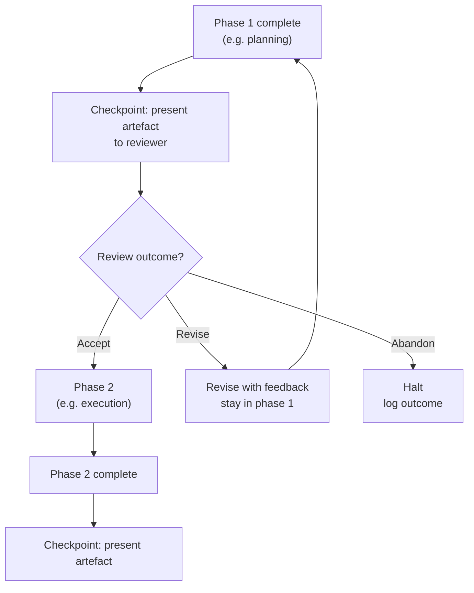

### Implementation pattern

Checkpoint review differs from approval gating in that the agent actively summarises its work. The reviewer is not reading raw tool logs — they are reading a purpose-built summary.

```go
type Checkpoint struct {
    Phase     string
    Artefact  string // human-readable summary of phase output
    Evidence  []SourceRef // traceable links back to data sources
    NextPhase string
    RiskTier  RiskTier
}

type CheckpointReviewer interface {
    Present(ctx context.Context, cp Checkpoint) (ReviewDecision, error)
}

type ReviewDecision struct {
    Outcome   ReviewOutcome // Accept, Revise, Abandon
    Feedback  string
}
```

---

## Pattern 3: Escalation

The agent detects that it cannot proceed — due to uncertainty, conflict, missing information, or hitting a capability boundary — and hands off to a human with enough context to resolve the blocker and resume.

Escalation is an agent capability, not a failure mode. An agent that never escalates is either operating in a trivially simple domain or hiding failures.

### Escalation triggers

Define escalation conditions explicitly. Vague triggers ("escalate when unsure") produce escalations that humans cannot act on.

| Trigger | Description |
|---|---|
| **Confidence below threshold** | Agent's self-assessed confidence on a critical decision drops below a minimum |
| **Conflicting sources** | Two authoritative sources disagree and the agent cannot resolve the conflict by precedence rules |
| **Tool unavailability** | A required tool is unavailable and no alternative exists |
| **Missing required information** | The task requires information the agent does not have and cannot retrieve |
| **Policy hit** | The agent detects it would violate a policy if it proceeded |
| **Repeated failure** | The same step has failed N times and the agent cannot find an alternative |

```go
type EscalationTrigger struct {
    Reason      EscalationReason
    Context     string // what the agent was trying to do
    Blocker     string // what stopped it
    Suggestion  string // agent's best guess at resolution, if any
    PartialWork []CompletedStep // what was completed before escalation
}

type EscalationChannel interface {
    Escalate(ctx context.Context, trigger EscalationTrigger) error
    Resume(ctx context.Context, escalationID string) (ResumeSignal, error)
}
```

### Resumption

After a human resolves the blocker, the agent must be able to resume from where it left off. This requires:

1. Persisting agent state at the point of escalation (not just the escalation trigger)
2. A resumption mechanism that injects the human's resolution into the agent's context
3. A clear entry point to re-enter the loop

```go
type AgentState struct {
    TaskID      string
    History     []Message
    CompletedSteps []CompletedStep
    PendingStep    PlanStep
    Memory      MemorySnapshot
}

func (a *Agent) Suspend(ctx context.Context, state AgentState, trigger EscalationTrigger) (string, error) {
    suspendID := newID()
    if err := a.stateStore.Save(ctx, suspendID, state); err != nil {
        return "", fmt.Errorf("saving agent state: %w", err)
    }
    trigger.Context = fmt.Sprintf("[suspendID: %s] %s", suspendID, trigger.Context)
    return suspendID, a.escalationChannel.Escalate(ctx, trigger)
}

func (a *Agent) Resume(ctx context.Context, suspendID string, resolution string) error {
    state, err := a.stateStore.Load(ctx, suspendID)
    if err != nil {
        return fmt.Errorf("loading agent state: %w", err)
    }
    // Inject the human's resolution and re-enter the loop.
    state.History = append(state.History, Message{
        Role:    "system",
        Content: "Human resolution: " + resolution,
    })
    return a.continueFrom(ctx, state)
}
```

---

## Audit Trails

Every HITL interaction must produce an immutable audit record. This is not optional for production agents — it is the evidence that a human was in the loop when required.

### What to record

```go
type AuditEvent struct {
    Timestamp   time.Time
    AgentID     string
    TaskID      string
    EventType   AuditEventType // ApprovalRequested, ApprovalGranted, Escalated, Resumed, ...
    Actor       string         // agent identifier or human identity
    Action      *ToolCall      // the action under review (if applicable)
    Decision    *string        // the human's decision (if applicable)
    Rationale   string         // why this event occurred
    RiskTier    RiskTier
    TraceID     string         // correlation to distributed trace
}
```

### Storage requirements

- Append-only (no updates or deletes)
- Queryable by task, agent, actor, date range, and event type
- Retention aligned with compliance requirements (typically 1–7 years)
- Accessible to auditors independently of the agent runtime

---

## Composing HITL with Other Patterns

HITL is not a standalone pattern — it wraps other patterns at risk boundaries.

| Base pattern | HITL addition |
|---|---|
| ReAct | Approval gate before any tool with `riskTier >= High` |
| Plan-Execute | Checkpoint review after planning phase, before execution |
| Orchestrator/Worker | Escalation when a worker result conflicts with another |
| Reflection | Checkpoint review when critic flags a blocking quality failure after max rounds |
| Pipeline | Approval gate at stage boundaries that produce irreversible side effects |

A practical default: **Plan-Execute with checkpoint review after planning and approval gates before high-risk tools**. This covers the majority of production use cases without over-engineering.

---

## Anti-Patterns

**Rubber-stamp gates:** If the approval UI does not show rationale and evidence, reviewers will approve everything. The gate exists on paper but not in practice.

**Silent failure:** The agent fails silently rather than escalating. When it eventually produces output, no one knows which steps were skipped.

**Escalation without state:** The agent escalates but discards its state. The human must restart the task from scratch.

**Over-gating:** Every action requires approval. The agent is slower than a human doing the work manually and reviewers stop reading requests carefully.

**Under-gating:** No gates on actions the agent classifies as medium risk even when the aggregate effect of many medium-risk actions is high risk.

