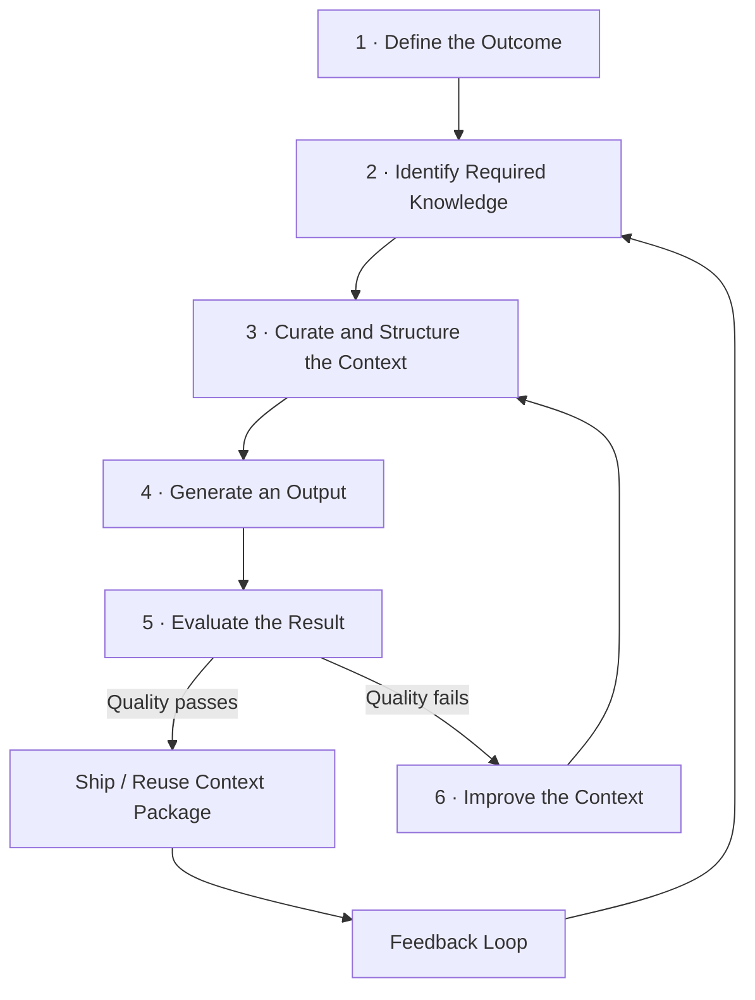

# Context Engineering 101

Context engineering is the practice of giving an AI system the right information, in the right shape, at the right time, so it can produce useful, reliable output.

If prompt engineering is "how you ask," context engineering is "what the AI knows when it answers."

---

## Why This Matters

Most poor AI results are not caused by a weak model. They are caused by weak context:

- Missing business rules
- Missing system constraints
- Stale or conflicting information
- No examples of what "good" looks like

When context is engineered well, output quality improves quickly and becomes more repeatable across teams.

---

## The Basic Mental Model

Think in this sequence:

1. **Task** - What exact outcome do we need?
2. **Context** - What knowledge is required to do that safely and correctly?
3. **Format** - How should the result be structured?
4. **Verification** - How do we know the result is correct?
5. **Feedback** - How do we improve the context after each run?

The model is only one part of the system. Context quality determines whether the model can perform well on real work.



---

## What Counts as "Context"?

Context is not only a long prompt. It includes:

- **Instructions:** objective, audience, scope, and boundaries
- **Reference material:** docs, tickets, architecture notes, runbooks, and policies
- **Examples:** approved outputs, templates, and prior high-quality work
- **Constraints:** compliance, style, tooling, and technical limitations
- **Live state:** current code, open tasks, incidents, and recent decisions
- **Evaluation criteria:** definition of done, quality checks, and failure conditions

---

## High-Level Context Engineering Process

Use this as a simple operating loop.

### 1) Define the Outcome

Write a one-sentence success condition.  
Example: "Produce a rollout plan for feature X that includes risk controls and owner handoffs."

### 2) Identify Required Knowledge

List only what is needed for this task:

- System boundaries
- Relevant policies
- Known constraints
- Source-of-truth documents

Avoid dumping every document into the prompt.

### 3) Curate and Structure the Context

Turn raw information into a usable context package:

- Short task brief
- Key facts and constraints
- 1-3 representative examples
- Expected output format
- Checks the AI must pass before finalizing

### 4) Generate an Output

Run the task with the curated package. Prefer deterministic structure (headings, bullet patterns, schemas) over open-ended output.

### 5) Evaluate the Result

Score quality against a rubric:

- Correctness
- Completeness
- Policy compliance
- Practical usefulness

### 6) Improve the Context

If output is weak, improve context first (missing facts, unclear constraints, poor examples) before changing models.

---

## How To Get Started (Week 1)

Start small with one repeatable workflow.

1. Pick one task done at least weekly.
2. Write a one-page context brief for that task.
3. Add two strong examples (good output and bad output).
4. Define a 5-point quality checklist.
5. Run 5-10 trials and track failure patterns.
6. Update context artifacts based on those patterns.

If you cannot explain why an output failed, your context package is still too vague.

---

## Common Mistakes

- Treating context as a one-time prompt instead of a managed asset
- Including too much data with no prioritization
- Omitting constraints and then blaming the model
- No quality rubric (result is judged by "feel")
- No feedback loop from real usage

---

## Practical Deliverables

A minimal context engineering setup usually includes:

- Task brief template
- Context source list
- Reusable examples library
- Quality rubric/checklist
- Change log for context updates

These artifacts create consistency across people, models, and use cases.

### Recommended Folder Structure

One directory per repeatable workflow. Each maps directly to the five deliverables above and mirrors a test suite: spec → fixtures → assertions → change log.

```
context/
├── _template/                              # Copy this to bootstrap any new workflow
│   ├── brief.md                            # Objective, audience, definition of done
│   ├── sources.md                          # Authoritative sources and freshness rules
│   ├── examples/
│   │   ├── good/                           # Approved outputs with inline annotations
│   │   └── bad/                            # Failure examples with notes on what went wrong
│   ├── rubric.md                           # Quality checklist the AI must pass
│   └── changelog.md                        # Dated log of every context update and why
├── incident-triage/
│   ├── brief.md
│   ├── sources.md
│   ├── examples/
│   │   ├── good/
│   │   │   └── mtts-mss-tls-2026-04-03.md # Full root-cause chain with traced evidence
│   │   └── bad/
│   │       └── premature-conclusion.md     # Diagnosis with no evidence trail
│   ├── rubric.md
│   └── changelog.md
├── sprint-planning/
│   └── ...
└── README.md                               # What workflows exist, who owns them, how to add one
```

A few design choices worth noting:
- `examples/` uses `good/` and `bad/` subdirectories so each can grow independently — one flat file per category doesn't scale.
- Filenames describe the case, not the role. The directory already tells you whether it is a positive or negative example.
- `changelog.md` makes the feedback loop concrete — every time a trial reveals a gap, record what changed and why.
- The whole `context/` tree belongs in version control alongside the code it supports.

---

# Context Engineering Part 2: Practical Go Example

This page shows a practical way to build a context package for a real engineering task.

It uses Go-flavored pseudocode so teams can move from concept to implementation quickly.

---

## Example Scenario

Task: "Create an implementation plan for a Jira epic, grounded in current code and architecture decisions."

Sources:

- Jira for delivery intent and acceptance criteria
- Confluence for architecture/process decisions
- GitHub for implementation truth and change history

Output:

- A structured context package passed to an LLM through the gateway
- Traceable references to each source
- A confidence and conflict summary

---

## Step-by-Step Build Flow

### Step 1: Define the context contract

```go
type BuildContextRequest struct {
	TaskID          string   // Internal request id
	JiraIssueKey    string   // e.g., "IE-1234"
	ConfluencePages []string // relevant page IDs or URLs
	Repo            string   // e.g., "owner/repo"
	Branch          string   // usually default branch for truth
	RiskTier        string   // high | medium | low
}

type ContextPackage struct {
	TaskBrief        string
	Sources          []SourceRef
	Sections         []Section
	Conflicts        []Conflict
	ValidationReport ValidationReport
	BudgetReport     BudgetReport
}
```

### Step 2: Fetch source snapshots

```go
func FetchSnapshots(ctx context.Context, req BuildContextRequest) (Snapshots, error) {
	jira, err := jiraClient.GetIssue(ctx, req.JiraIssueKey)
	if err != nil {
		return Snapshots{}, err
	}

	pages, err := confluenceClient.GetPages(ctx, req.ConfluencePages)
	if err != nil {
		return Snapshots{}, err
	}

	repoState, err := githubClient.GetRepoState(ctx, req.Repo, req.Branch)
	if err != nil {
		return Snapshots{}, err
	}

	return Snapshots{
		Jira:       jira,
		Confluence: pages,
		GitHub:     repoState,
	}, nil
}
```

### Step 3: Normalise into common sections

```go
func Normalise(s Snapshots) []Section {
	return []Section{
		{Kind: "task_brief", Content: FromJiraIntent(s.Jira)},
		{Kind: "acceptance_criteria", Content: FromJiraAC(s.Jira)},
		{Kind: "decisions", Content: FromConfluenceDecisions(s.Confluence)},
		{Kind: "runbook_constraints", Content: FromConfluenceRunbooks(s.Confluence)},
		{Kind: "implementation_truth", Content: FromGitHubState(s.GitHub)},
		{Kind: "test_and_ci_signals", Content: FromGitHubChecks(s.GitHub)},
	}
}
```

### Step 4: Apply precedence and detect conflicts

```go
func ResolveConflicts(sections []Section) ([]Section, []Conflict) {
	// Precedence:
	// 1) GitHub for implemented behavior
	// 2) Jira for planned delivery intent
	// 3) Confluence for decision rationale
	//
	// Any material mismatch is not silently overwritten.
	// It is carried forward as an explicit conflict.

	var conflicts []Conflict
	resolved := make([]Section, 0, len(sections))

	// Pseudocode: detect contradictions and annotate chosen source.
	// ...

	return resolved, conflicts
}
```

### Step 5: Enforce a context budget

```go
type BudgetPolicy struct {
	MaxTokensTotal int
	MaxPerSection  map[string]int
	ReserveForUser int // keep room for user's additional input
	ReserveForLLM  int // keep room for model response
}

type BudgetReport struct {
	UsedTotal      int
	UsedPerSection map[string]int
	Trimmed        []string // section kinds that were summarised
}

func ApplyBudget(sections []Section, p BudgetPolicy) ([]Section, BudgetReport) {
	// Strategy:
	// 1) Keep high-priority sections as-is
	// 2) Summarise medium-priority sections
	// 3) Drop low-value duplicates
	// 4) Never drop constraints/conflicts/acceptance criteria
	//
	// Pseudocode implementation omitted for brevity.
	return sections, BudgetReport{}
}
```

### Step 6: Validate before send

```go
func Validate(pkg ContextPackage) ValidationReport {
	return ValidationReport{
		HasTraceableSources: CheckSourceLinks(pkg),
		HasFreshnessMeta:    CheckFreshness(pkg),
		HasConflictFlags:    CheckConflictDisclosure(pkg),
		HasUnknowns:         CheckUnknowns(pkg),
		Pass:                true, // set from checks above
	}
}
```

### Step 7: Emit package to gateway

```go
func BuildAndSend(ctx context.Context, req BuildContextRequest) (LLMResponse, error) {
	snapshots, err := FetchSnapshots(ctx, req)
	if err != nil {
		return LLMResponse{}, err
	}

	sections := Normalise(snapshots)
	sections, conflicts := ResolveConflicts(sections)

	sections, budget := ApplyBudget(sections, DefaultBudgetFor(req.RiskTier))

	pkg := ContextPackage{
		TaskBrief:        "Implementation plan for " + req.JiraIssueKey,
		Sources:          CollectSources(snapshots),
		Sections:         sections,
		Conflicts:        conflicts,
		ValidationReport: Validate(ContextPackage{Sections: sections, Conflicts: conflicts}),
		BudgetReport:     budget,
	}

	if !pkg.ValidationReport.Pass {
		return LLMResponse{}, fmt.Errorf("context package validation failed")
	}

	return gatewayClient.Generate(ctx, pkg)
}
```

---

## Starter Context Budget (Practical Default)

Start with a simple budget that is easy to explain and tune.

Example total budget: `12,000` tokens

- `2,000` reserved for user follow-up input
- `3,000` reserved for model output
- `7,000` available for context package

Suggested section budget for the `7,000` context tokens:

- Task brief + acceptance criteria: `1,200`
- Implementation truth (GitHub): `2,200`
- Decisions/runbooks (Confluence): `1,600`
- Delivery context (Jira details): `1,200`
- Constraints, conflicts, unknowns: `800`

This is intentionally conservative. It prevents overfilling context windows and makes failures easier to diagnose.

---

## Budget Management Rules of Thumb

- Do not add raw documents if summaries with references are enough.
- Prefer newest and most authoritative artifacts over long history.
- Keep constraints and acceptance criteria in full fidelity.
- Summarise duplicates across sources into one canonical statement.
- Always include a budget report in debugging logs.

If output quality drops, inspect budget trimming decisions first.

---

## Advanced budgeting

For dynamic profiles, compression choices, observability, and escalation rules, see [Part 4 - advanced context budgeting](context-engineering-context-budget-advanced.md).

For most teams, start with the fixed budget above and evolve only after collecting real usage data.
